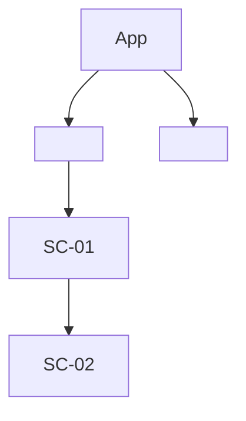
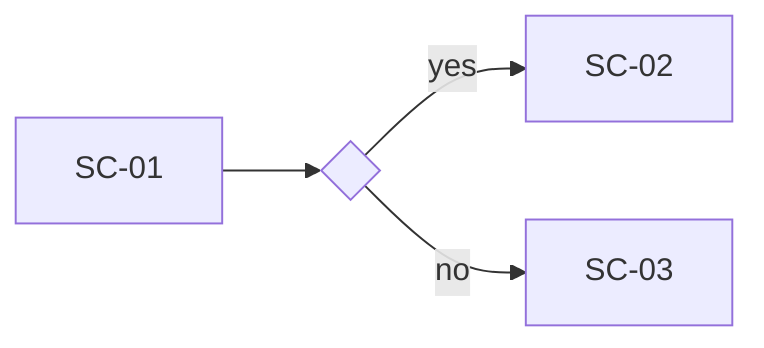

# Information architecture

What screens exist, how they connect, and which path a user takes through them for each core journey. Structure only: no visual design here.

## Screens

| ID | Screen | Purpose (one line) | Requirements | Platforms | Access |
| --- | --- | --- | --- | --- | --- |
| SC-01 | <name> | <what the user does here> | F-01, F-02 | web, ios, android | signed-in |

Access: `public` · `signed-in` · `<role>` (as defined in the BRD).

## Navigation

<Navigation pattern per platform (e.g. bottom tabs on mobile, side bar on web), entry points (deep links, notifications, emails), and where sign-in is required.>

## Core journeys

One flowchart per journey from the BRD. Include decision points and the main error path.

### J-01 <journey name>

## Requirement coverage

Every `must` requirement appears on at least one screen. A screen with no requirement is scope creep and is flagged.

| Requirement | Priority | Screens | Covered |
| --- | --- | --- | --- |
| F-01 | must | SC-01 | yes |

Screens without a requirement: <none, or list with reason>

## Open questions

- [ ] <question that needs a prototype or a BRD decision>

## Change log

| Date | Change | Change ID |
| --- | --- | --- |
