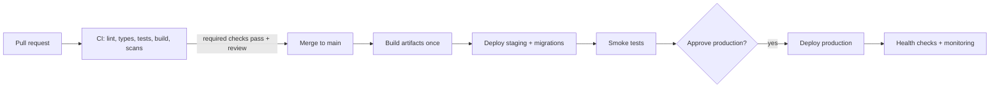

# CI/CD pipeline

## Flow

## Stages

For each stage: decision, or "not needed because …".

| # | Stage | Decision | Workflow file | Required check? |
| --- | --- | --- | --- | --- |
| 1 | Triggers, branches, protection | | | |
| 2 | CI on pull requests | | `ci.yml` | yes |
| 3 | Security and supply chain (SAST, dependencies, secrets, images, DAST on staging, `SECURITY.md`; threats covered by `ci`) | | `security.yml`, `dependabot.yml`, `deploy.yml` (DAST) | |
| 4 | Build once, deploy many | | | |
| 5 | Database migrations | | | |
| 6 | Continuous delivery (staging, production) | | `deploy.yml` | |
| 7 | Mobile builds and distribution | | `mobile.yml` | |
| 8 | Secrets and access | | | |
| 9 | Release management | | `release.yml` | |
| 10 | Rollback | | | |
| 11 | After deploy: health, errors, alerts, backups | | | |
| 12 | Cost control | | | |

## CI jobs per layer

| Layer | Runs when paths change | Jobs (commands from the layer guide) |
| --- | --- | --- |
| db | | migration check |
| backend | | lint, types, unit, integration, build |
| web | | lint, types, unit, build, e2e (critical) |
| mobile | | lint, types, unit |
| infra | `.github/**` | actionlint |

Aggregate required check: `ci-ok` (passes only if every triggered job passed).

## Migration strategy

<When migrations run, expand/contract rule, backup before production migration, failure handling.>

## Rollback

| Component | How | Target time |
| --- | --- | --- |

## Monitoring and alerts

<What is watched, who is alerted, where.>

## Open questions

- [ ] <question>
