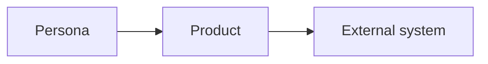
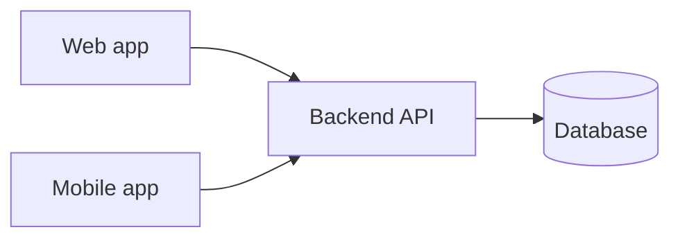
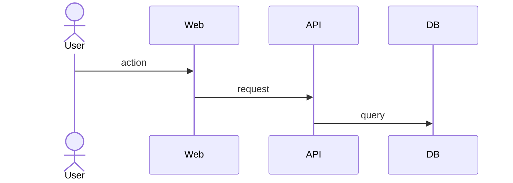

# Architecture

## Context

<One sentence per external system: what it does for us and what happens when it is down.>

## Containers

| Container | Technology | Responsibility | Requirements |
| --- | --- | --- | --- |

## Modules (domain boundaries)

| Module | Owns (glossary terms) | Exposes | Depends on |
| --- | --- | --- | --- |

## Authentication and authorisation

<How users sign in on each platform; roles and permissions mapped to BRD business rules.>

## API and error conventions

<Resource naming, versioning, pagination, error format, validation, idempotency where needed.>

## Core journeys

### J-01 <name>

## Quality attributes

| N-xx | Requirement | How it is met | How it is verified |
| --- | --- | --- | --- |

## Observability

<Logging rules (no personal data), error tracking, health checks, product analytics events for BRD success metrics.>

## Open questions

- [ ] <question>
