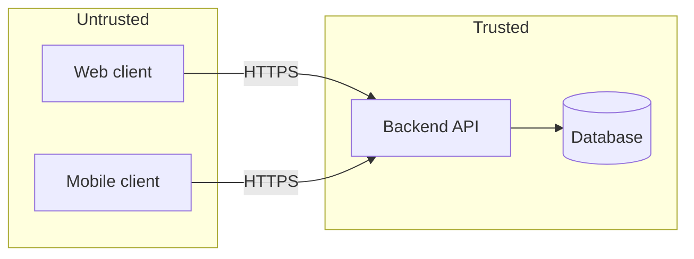

# Threat model

Lightweight, per core journey and trust boundary. Every threat has a mitigation and a way to verify it. Tasks reference threats by ID (`threats: [TH-03]`); the backlog checker reports threats no task or check covers.

## Assets and data classification

| Asset / data | Class | Where it lives | Who may access |
| --- | --- | --- | --- |
| <e.g. account email> | personal | users table | the user, admins |

Classes: `public` · `internal` · `personal` · `sensitive` (special categories, financial, health, credentials).

## Actors

| Actor | Trust | Notes |
| --- | --- | --- |
| anonymous visitor | none | |
| signed-in user | own data only | |
| other signed-in user | none for this user's data | the most common real attacker |
| admin | elevated | |

## Trust boundaries

## Threats

STRIDE per journey and boundary: **S**poofing, **T**ampering, **R**epudiation, **I**nformation disclosure, **D**enial of service, **E**levation of privilege. Include the misuse cases from the BRD (`MC-xx`).

| ID | Journey / boundary | STRIDE | Threat | Likelihood × impact | Mitigation | Verified by | Covered by | ASVS ref |
| --- | --- | --- | --- | --- | --- | --- | --- | --- |
| TH-01 | J-01 / API | E | user reads another user's resource by changing an ID | high | authorisation check on every object access, server side | negative integration test per endpoint | task / ci / accepted | |

- **Verified by:** test (name the seam), CI check, or manual review.
- **Covered by:** `task` (a task lists it in `threats:`), `ci` (an automated check in `pipeline.md`), or `accepted` (the user accepted the risk; reason and date below).

## Security baseline decisions

| Topic | Decision | ADR |
| --- | --- | --- |
| Authentication | <proven library or provider; never home-made> | |
| Password storage | <algorithm and parameters, or delegated to provider> | |
| Session / token handling (web) | <cookie flags or token storage> | |
| Token storage (mobile) | <platform secure storage> | |
| Authorisation model | <where checks live; deny by default> | |
| Input validation and output encoding | | |
| Rate limiting and abuse protection | | |
| Security headers, CORS | | |
| Secrets (local, CI, runtime) | | |
| Logging and audit trail | <what is logged, no personal data or secrets> | |
| Dependency policy | <update cadence, vulnerability thresholds that block a merge> | |
| Encryption in transit / at rest | | |

## Accepted risks

| Threat | Reason | Accepted by / date | Revisit |
| --- | --- | --- | --- |

## Professional review

<Needed when the product handles payments, health data, other special categories, or operates at large scale. Record whether and when an external audit or penetration test is planned.>
