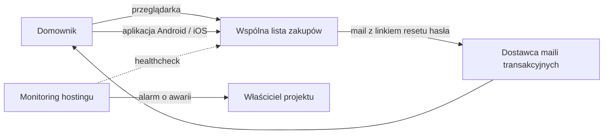
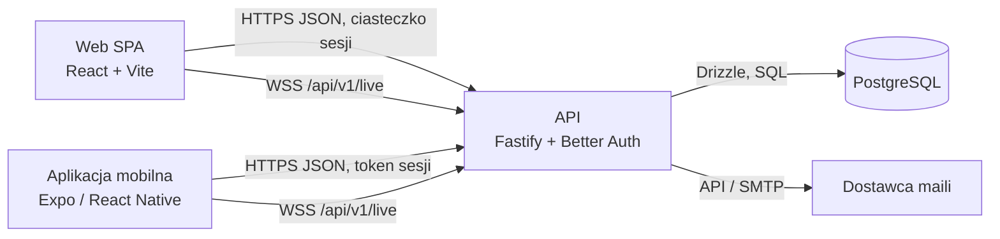
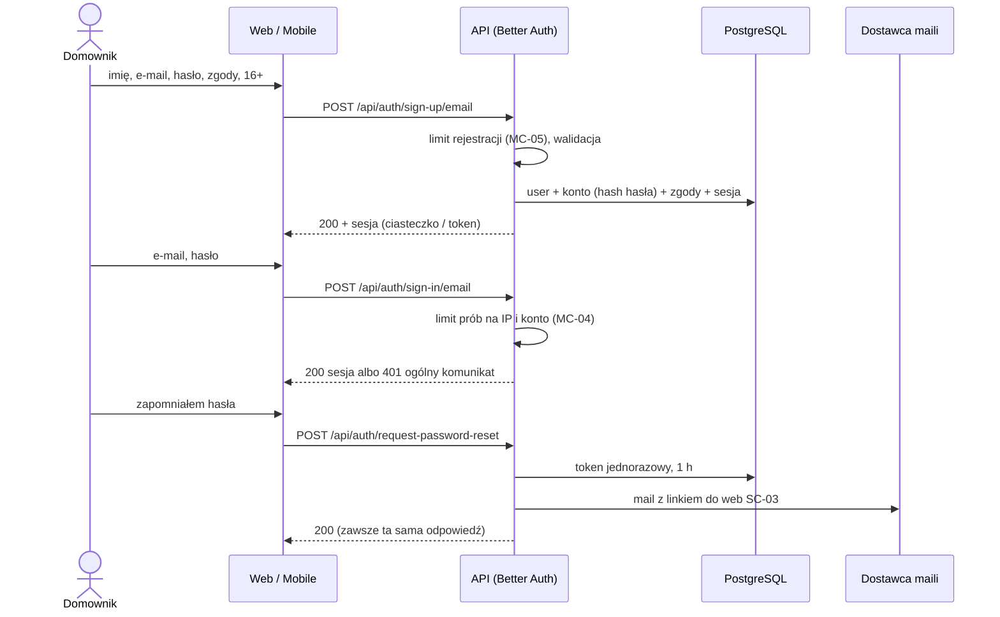
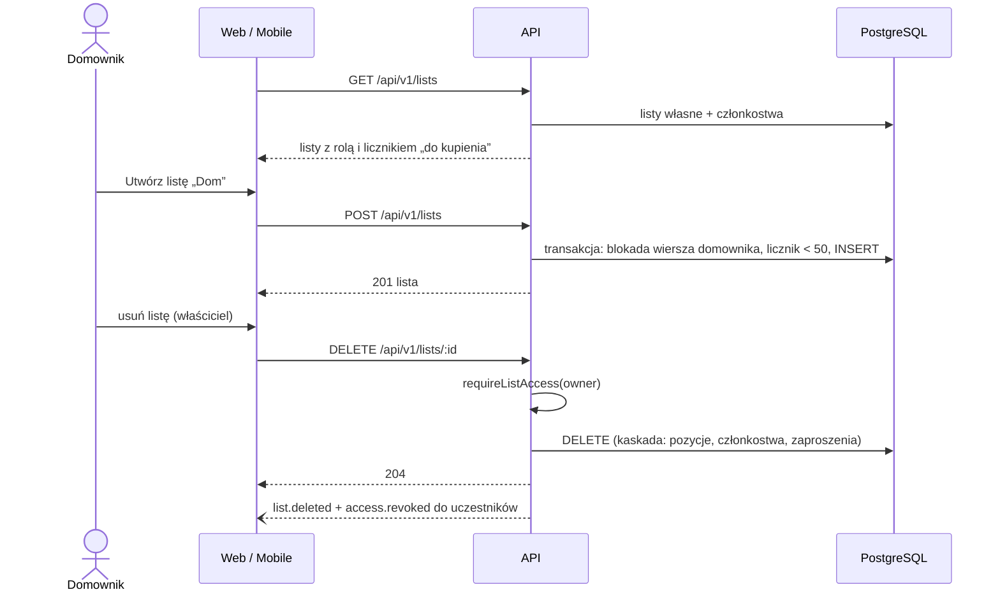

# Architektura

Stos: `tech-stack.md`. Decyzje trudne do odwrócenia: `docs/adr/`. Nazwy z słownika BRD (§14): domownik, lista, pozycja, właściciel, uczestnik, link zaproszenia, odhaczenie.

## Kontekst



- **Dostawca maili transakcyjnych** (wybór w `/ci-cd`): wysyła wyłącznie mail resetu hasła (F-03). Gdy nie działa, reset hasła jest niedostępny; reszta aplikacji działa. Odpowiedź na prośbę o reset jest i tak taka sama (bez zdradzania błędu wysyłki); błąd trafia do logów.
- **Monitoring hostingu** (wybór w `/ci-cd`): odpytuje `/health` i wysyła mail do właściciela projektu przy awarii (N-03).

Brak innych systemów zewnętrznych: bez analityki, śledzenia błędów, push i płatności (N-02, BRD §11).

## Kontenery



| Kontener | Technologia | Odpowiedzialność | Wymagania |
| --- | --- | --- | --- |
| Web SPA (`apps/web`) | React + Vite, CSS Modules, tokeny jako zmienne CSS | ekrany SC-01…SC-09 w przeglądarce (telefon i komputer); strona docelowa linków zaproszenia i resetu hasła | N-01, N-04, N-05 |
| Aplikacja mobilna (`apps/mobile`) | Expo / React Native, expo-router | ekrany SC-01…SC-09 jako aplikacja natywna (Android, iOS) | N-01, N-04 |
| API (`apps/api`) | Fastify, Better Auth, Drizzle, `@fastify/websocket`, pino | konta i sesje, reguły biznesowe, uprawnienia, zmiany na żywo, wysyłka maila resetu | F-01…F-16, N-02, N-03, N-06 |
| Pakiet wspólny (`packages/shared`) | TypeScript, zod | schematy walidacji, typy żądań/odpowiedzi i zdarzeń na żywo, kody błędów, limity (jedno miejsce dla reguł długości i limitów) | F-01, F-05, F-07, F-16 |
| Tokeny (`packages/tokens`) | Style Dictionary | generuje `tokens.css` (web) i `tokens.ts` (mobile) z `docs/design/tokens.json` | N-04 |
| Baza danych | PostgreSQL | dane kont, list, pozycji, zaproszeń, sesji; kopia raz dziennie, 7 dni (N-03) | N-03 |

API działa jako **jedna instancja** (ADR 0003): rozsyłanie zdarzeń na żywo odbywa się w pamięci procesu. Odrzucone jako zbędne dla wymagań: mikroserwisy, kolejka wiadomości, Redis/cache, osobny serwis realtime, BFF dla mobile.

## Moduły (granice domenowe)

Moduły w `apps/api/src/modules/<moduł>`. Każdy moduł ma warstwę domenową (reguły, bez Fastify i Drizzle) i adaptery (trasy HTTP, repozytoria). Kierunek zależności sprawdzany w CI (`CODING_STANDARDS.md`).

| Moduł | Posiada (słownik) | Udostępnia | Zależy od |
| --- | --- | --- | --- |
| `konta` | domownik (imię, e-mail, zgody), sesja | rejestracja, logowanie, wylogowanie, reset hasła (przez Better Auth), `GET/PATCH /me`, usunięcie konta (F-04, F-16); `requireUser()` dla tras | `listy` (usunięcie konta), `na-zywo` |
| `listy` | lista, właściciel, uczestnik (członkostwo) | CRUD list, przegląd list (F-05, F-06), uczestnicy (F-13); **`requireListAccess(userId, listId, rola)` — jedyne miejsce sprawdzania dostępu do listy** | `na-zywo` |
| `pozycje` | pozycja, odhaczenie, blokada duplikatu | CRUD pozycji, odhaczanie, usuń odhaczone (F-07…F-10) | `listy` (dostęp), `na-zywo` |
| `zaproszenia` | link zaproszenia | tworzenie, unieważnianie, podgląd i przyjęcie zaproszenia (F-11, F-12) | `listy` (dostęp, członkostwo, limit 20), `na-zywo` |
| `na-zywo` | subskrypcja, zdarzenie | WebSocket `/api/v1/live`, `publish(zdarzenie)`, `revoke(userId, listId)`, `closeSession(sessionId)` (F-14, MC-03) | `listy` (sprawdzenie dostępu przy subskrypcji) |
| `statystyki` | aktywność dzienna listy | zapis aktywności przy odhaczeniu; zapytania SQL miar sukcesu (BRD §10) | — |

Front (web i mobile) dzieli się według ekranów z IA; logika pobierania danych w hookach (TanStack Query), komponenty tylko renderują.

## Uwierzytelnianie i autoryzacja

**Logowanie** (ADR 0002): Better Auth, e-mail + hasło, sesje zapisane w PostgreSQL.

| Platforma | Jak przenoszona jest sesja | Jak chroniona |
| --- | --- | --- |
| Web | ciasteczko sesji `HttpOnly`, `Secure`, `SameSite=Lax`; web i API pod jednym originem: API pod `/api/v1` tego samego adresu, który serwuje web (ADR 0006) | sprawdzenie nagłówka `Origin` (lista zaufanych originów Better Auth) dla żądań zmieniających stan i dla połączenia WebSocket |
| Mobile | token sesji w `expo-secure-store` (plugin Expo Better Auth), wysyłany w nagłówku | Keychain / Keystore; nigdy w AsyncStorage ani logach |

- Sesja wygasa po 30 dniach bez użycia (przedłużana przy użyciu). Wylogowanie usuwa sesję w bazie i zamyka jej połączenia WebSocket (`na-zywo.closeSession`).
- Reset hasła: jednorazowy token Better Auth ważny 1 godzinę (F-03); po ustawieniu nowego hasła wszystkie sesje konta są unieważniane.
- Hasła: domyślny algorytm Better Auth (scrypt); żadnej własnej kryptografii.
- Rejestracja zapisuje akceptację regulaminu i polityki prywatności oraz potwierdzenie 16+ (znaczniki czasu i wersja dokumentów) jako pola konta (F-01).

**Autoryzacja** — reguły z BRD, sprawdzane po stronie serwera przy każdej operacji, domyślnie odmowa:

| Operacja | Właściciel | Uczestnik | Inny zalogowany | Anonim |
| --- | --- | --- | --- | --- |
| odczyt listy, pozycji, uczestników | ✔ | ✔ | 404 | 401 |
| dodanie / edycja / odhaczenie / usunięcie pozycji, usuń odhaczone | ✔ | ✔ | 404 | 401 |
| zmiana nazwy / usunięcie listy | ✔ | 403 | 404 | 401 |
| tworzenie / unieważnianie linku zaproszenia, usunięcie uczestnika | ✔ | 403 | 404 | 401 |
| e-maile uczestników | ✔ | — (pole pominięte) | 404 | 401 |
| opuszczenie listy | 403 (może usunąć listę) | ✔ | 404 | 401 |
| podgląd zaproszenia (SC-08) | ważny token | ważny token | ważny token | ważny token (tylko nazwa listy i imię właściciela) |
| przyjęcie zaproszenia | komunikat „to twoja lista” | komunikat „już jesteś na liście” | ✔ | 401 |

Dostęp do listy daje wyłącznie: `lista.owner_id = ja` albo wiersz członkostwa. Brak dostępu zwraca 404 (nie zdradza istnienia listy, MC-01). Sprawdzenie robi jedna funkcja `requireListAccess` w module `listy`; trasy nie piszą własnych warunków.

## Konwencje API i błędów

- REST + JSON pod `/api/v1/…`; Better Auth pod `/api/auth/…`; WebSocket `/api/v1/live`. Prefiks wersji, bo zainstalowane aplikacje mobilne mogą być starsze niż API.
- Identyfikatory: UUID (v7). Klient może podać `id` nowej pozycji: powtórzone żądanie z tym samym `id` zwraca istniejącą pozycję (200) zamiast ostrzeżenia o duplikacie (bezpieczne ponawianie przy słabym zasięgu, F-15).
- Walidacja: schematy zod z `packages/shared`, po stronie serwera zawsze; klient waliduje tymi samymi schematami dla szybkiej informacji. Odrzucamy, nie poprawiamy (wyjątek: obcięcie białych znaków na brzegach nazw).
- Kolekcje bez stronicowania: ograniczone limitami biznesowymi (50 list, 500 pozycji, 20 uczestników).
- Format błędu: `{ "error": { "code": "duplicate_item", "fields"?: { "name": "too_long" }, "limit"?: "items" } }`. Klient mapuje `code` na polskie komunikaty z ekranów; serwer nie wysyła tekstów dla użytkownika.

| HTTP | `code` | Kiedy |
| --- | --- | --- |
| 400 | `validation_failed` | długości, puste pola, brak zgód (`fields` wskazuje pola) |
| 401 | `unauthenticated` | brak lub nieważna sesja |
| 401 | `invalid_credentials` | zły e-mail lub hasło przy logowaniu (ten sam dla obu, F-02) |
| 403 | `invalid_origin` | żądanie zmieniające stan z obcego `Origin` (TH-14) |
| 403 | `owner_only`, `owner_cannot_leave` | uczestnik próbuje akcji właściciela; właściciel opuszcza listę |
| 404 | `not_found` | lista lub pozycja nie istnieje albo brak dostępu |
| 409 | `duplicate_item` | F-09 |
| 409 | `limit_reached` (`limit`: `lists` \| `items` \| `participants`) | F-05, F-07, F-12 |
| 409 | `email_taken` | F-01 |
| 410 | `invitation_invalid` | link wykorzystany, wygasły lub unieważniony (F-11) |
| 409 | `already_member`, `own_list` | F-12 |
| 429 | `rate_limited` | MC-04, MC-05 |
| 500 | `internal` | błąd serwera; szczegóły tylko w logach z identyfikatorem żądania |

- Konflikty (F-14): ostatni zapis wygrywa (zwykły `UPDATE`); edycja usuniętej pozycji zwraca 404, klient pokazuje „pozycja usunięta przez inną osobę”.
- UI nie pokazuje zmiany jako zapisanej przed odpowiedzią serwera (bez optymistycznych aktualizacji, F-15).

## Zmiany na żywo (F-14, N-06, MC-03)

- Klient otwiera jedno połączenie WebSocket po zalogowaniu. Połączenie jest automatycznie zapisane do kanału `user:<id>`; ekran listy (SC-06, SC-07) wysyła `subscribe { listId }` i `unsubscribe`.
- Przy `subscribe` serwer sprawdza dostęp (`requireListAccess`); odmowa = `error not_found`.
- Po zatwierdzeniu transakcji moduł domenowy publikuje zdarzenie do kanału `list:<id>` (np. `item.upserted`, `item.deleted`, `items.cleared`, `list.updated`, `list.deleted`, `members.changed`, `invitations.changed`) oraz `lists.changed` do kanałów `user:<id>` wszystkich osób z dostępem (odświeżenie SC-05). Zdarzenia niosą zmieniony obiekt w kształcie odpowiedzi API.
- Utrata dostępu (usunięcie uczestnika, opuszczenie, usunięcie listy lub konta): `revoke(userId, listId)` wysyła `access.revoked` i natychmiast usuwa subskrypcję, zanim kolejne zdarzenie listy zostanie rozesłane (MC-03). Wylogowanie i usunięcie konta zamykają połączenia sesji.
- Serwer wysyła ping co 25 s; klient bez ponga przez 10 s uznaje połączenie za zerwane, pokazuje OfflineBanner i wyłącza akcje zapisu (F-15). Po powrocie połączenia klient ponownie subskrybuje i pobiera aktualny stan listy (F-15, AC3).
- Uwierzytelnienie połączenia: web — ciasteczko sesji przy upgrade + sprawdzenie `Origin`; mobile — token sesji w nagłówku upgrade. Nigdy token w adresie URL.

## Główne ścieżki

### J-01 Rejestracja i logowanie



### J-02 Zarządzanie listami



### J-03 Pozycje na liście

```mermaid
sequenceDiagram
  actor D as Domownik
  participant C as Web / Mobile
  participant A as API
  participant DB as PostgreSQL
  D->>C: dodaj „mleko”
  C->>A: POST /api/v1/lists/:id/items {id, name}
  A->>A: requireListAccess(member), walidacja
  A->>DB: transakcja: blokada listy, licznik < 500, INSERT (unikalny name_key)
  alt naruszenie unikalności name_key
    A-->>C: 409 duplicate_item
  else
    A-->>C: 201 pozycja
    A--)C: item.upserted do subskrybentów listy
  end
  D->>C: odhacz
  C->>A: PATCH /api/v1/lists/:id/items/:itemId {checked: true}
  A->>DB: checked_at, checked_by; aktywność dzienna
  A-->>C: 200 pozycja
```

### J-04 Udostępnianie listy

```mermaid
sequenceDiagram
  actor W as Właściciel
  actor Z as Zaproszony
  participant C as Web / Mobile
  participant A as API
  participant DB as PostgreSQL
  W->>C: Utwórz link zaproszenia
  C->>A: POST /api/v1/lists/:id/invitations
  A->>A: requireListAccess(owner), limit tworzenia linków
  A->>DB: token losowy 256 bit, ważny 7 dni
  A-->>C: 201 {url, expiresAt}
  W-->>Z: link dowolnym kanałem
  Z->>C: otwiera link (web SC-08)
  C->>A: GET /api/v1/invitations/:token
  A-->>C: nazwa listy, imię właściciela albo 410
  Z->>C: Przyjmij (po zalogowaniu / rejestracji)
  C->>A: POST /api/v1/invitations/:token/accept
  A->>DB: transakcja: UPDATE zaproszenia WHERE nieużyte, nieunieważnione, niewygasłe; limit 20; INSERT członkostwa
  A-->>C: 200 {listId}
  A--)C: members.changed, invitations.changed, lists.changed
```

### J-05 Wspólne zakupy

```mermaid
sequenceDiagram
  actor A1 as Ania
  actor T as Tomek
  participant CA as Klient Ani
  participant CT as Klient Tomka
  participant API as API
  CA->>API: WS subscribe {listId}
  CT->>API: WS subscribe {listId}
  API->>API: requireListAccess dla obu
  T->>CT: odhacza „mleko”
  CT->>API: PATCH item {checked: true}
  API-->>CT: 200
  API--)CA: item.upserted (w ułamku sekundy, limit 5 s)
  Note over API: właściciel usuwa Tomka z listy
  API--)CT: access.revoked; subskrypcja usunięta
  CT->>CT: komunikat i powrót do SC-05
  Note over CA,API: zerwane połączenie
  CA->>CA: OfflineBanner, zapisy wyłączone
  CA->>API: ponowne połączenie, subscribe, GET listy
```

## Atrybuty jakości

| N-xx | Wymaganie | Jak spełnione | Jak weryfikowane |
| --- | --- | --- | --- |
| N-01 | komputer i telefon | web responsywny mobile-first + aplikacja Expo (Android, iOS) korzystające z tego samego API | E2E Playwright (viewport telefonu i komputera), Maestro na Androidzie |
| N-02 | prywatność | autoryzacja przy każdej operacji, 404 dla cudzych list; e-mail tylko dla właściciela listy; brak zewnętrznej analityki; logi bez danych osobowych; usunięcie konta wg F-04 | negatywne testy integracyjne autoryzacji; test usunięcia konta; przegląd logów w QA |
| N-03 | dostępność usługi, brak utraty danych | jedna instancja API, zarządzany PostgreSQL z kopią dzienną (7 dni), `/health` + alarm mailowy (szczegóły w `/ci-cd`) | test odtworzenia kopii raz przed startem pilotażu (`/ci-cd`) |
| N-04 | WCAG 2.2 AA | tokeny z kontrastami sprawdzanymi przez `design-check`; komponenty z rolami i nazwami dostępnymi | `@axe-core/playwright`, eslint-plugin-jsx-a11y, eslint-plugin-react-native-a11y, testy po roli i nazwie, ręczne testy QA |
| N-05 | tylko polski | teksty w plikach komunikatów klienta (bez biblioteki i18n); `lang="pl"`; formaty dat `pl-PL` | testy komponentów na polskich tekstach |
| N-06 | zmiana widoczna ≤ 5 s | WebSocket, publikacja po zatwierdzeniu transakcji, bez odpytywania | test integracyjny dwóch klientów WS z limitem czasu; E2E J-05 z dwoma kontekstami przeglądarki |

## Obserwowalność

- **Logi:** pino w formacie JSON; każde żądanie ma `requestId`. Logujemy identyfikatory (użytkownik, lista), kody błędów, czasy. Nigdy: e-maile, imiona, nazwy list i pozycji, hasła, tokeny, ciasteczka (redakcja nagłówków `authorization`, `cookie`, pól `password`, `token`).
- **Zdarzenia bezpieczeństwa** (log `security`): nieudane logowanie, przekroczenie limitu, odmowa dostępu do listy, zmiana hasła, usunięcie konta, usunięcie uczestnika.
- **Healthcheck:** `GET /health` (proces) i `GET /health/ready` (połączenie z bazą); alarm mailowy z monitoringu hostingu.
- **Śledzenie błędów:** brak zewnętrznego narzędzia; błędy 5xx w logach hostingu. Aplikacja mobilna: błędy krytyczne widoczne w logach urządzenia podczas testów.
- **Miary sukcesu (BRD §10):** zapytania SQL w `apps/api/scripts/metrics.sql` na tabeli aktywności dziennej (moduł `statystyki`, `data-model.md`), uruchamiane ręcznie po 4 tygodniach.

## Otwarte pytania

Rozstrzygnięte 2026-10-26 (Tomasz Brążkiewicz):

- [x] **Design mobile:** aplikacja natywna używa tych samych specyfikacji SC-01…SC-09 co web, z konwencjami platformy (gest i przycisk „wstecz”, natywny arkusz zamiast okna dialogowego, bezpieczne obszary ekranu). Osobny przebieg `/brd-to-design` dla mobile nie jest potrzebny; taski mobile odwołują się do tych samych plików w `docs/design/screens/`.
- [x] **Linki:** link zaproszenia (SC-08) i link resetu hasła (SC-03) zawsze otwierają web, także na telefonie. Osoba używająca tylko aplikacji przyjmuje zaproszenie lub ustawia nowe hasło w przeglądarce telefonu, a potem wraca do aplikacji (lista pojawia się po odświeżeniu). Deep linki do aplikacji są poza MVP.

Otwarte:

- [x] Domena web i API: bez własnej domeny; Fastify serwuje API i zbudowany web pod jednym originem `lista-prod.fly.dev` (`deployment.md`, ADR 0006, 2026-10-26).

## Historia zmian

| Data | Zmiana |
| --- | --- |
| 2026-10-27 | T-004: kody `invalid_credentials` (401) i `invalid_origin` (403). |
| 2026-10-26 | `/ci-cd`: bez własnej domeny — web serwowany przez API pod jednym originem, CORS wyłączony (ADR 0006). |
