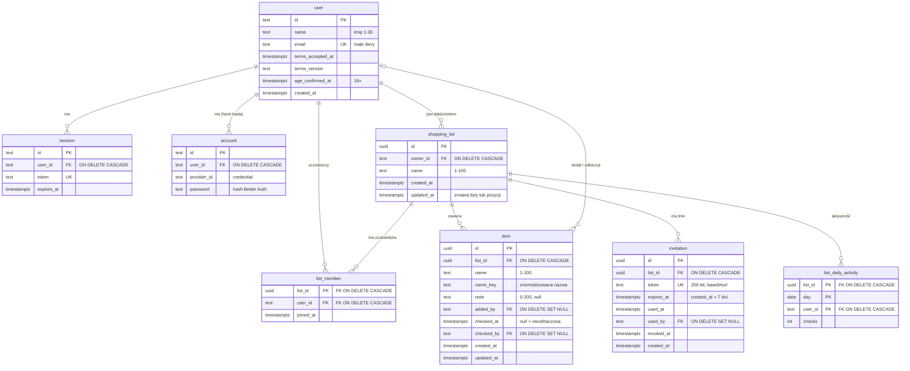

# Model danych

PostgreSQL, schemat w Drizzle (`apps/api/src/db/schema.ts`), migracje SQL w repo. Tabele Better Auth (`user`, `session`, `account`, `verification`, `rate_limit`) w kształcie wymaganym przez bibliotekę, rozszerzone o pola z BRD; tabele domenowe po angielsku w kodzie, z mapowaniem na słownik poniżej.

| Tabela | Termin ze słownika |
| --- | --- |
| `user` | domownik |
| `shopping_list` | lista (`owner_id` = właściciel) |
| `list_member` | uczestnik (członkostwo) |
| `item` | pozycja (`checked_at` = odhaczenie) |
| `invitation` | link zaproszenia |
| `list_daily_activity` | dane do miar sukcesu |

## Encje i relacje

## Ograniczenia i niezmienniki

| Reguła (BRD) | Jak egzekwowana |
| --- | --- |
| E-mail unikalny (F-01) | unikalny indeks na `user.email` (zapisywany małymi literami przez Better Auth) |
| Imię 1–30, nazwa listy 1–100, nazwa pozycji 1–100, notatka ≤ 200 (F-01, F-05, F-07, F-16) | schematy zod w `packages/shared` + `CHECK (char_length(...) BETWEEN ...)` w bazie |
| Duplikat pozycji bez rozróżniania wielkości liter, także wśród odhaczonych (F-09) | `name_key` = nazwa po `trim`, normalizacji Unicode NFC i `toLocaleLowerCase('pl-PL')` (funkcja w `packages/shared`); `UNIQUE (list_id, name_key)`. Zmiana nazwy tej samej pozycji na inną wielkość liter nie narusza indeksu (ten sam wiersz) |
| Limit 50 list na właściciela (F-05) | w transakcji: `SELECT … FOR UPDATE` na wierszu `user`, liczenie, `INSERT` |
| Limit 500 pozycji na listę (F-07) | w transakcji: `SELECT … FOR UPDATE` na wierszu `shopping_list`, liczenie, `INSERT` |
| Limit 20 uczestników (F-12) | jak wyżej, w transakcji przyjęcia zaproszenia |
| Właściciel nie jest wierszem `list_member` | dostęp = `owner_id = ja` OR istnieje `list_member`; `CHECK` w kodzie przyjęcia zaproszenia (`own_list`) |
| Link jednorazowy, 7 dni, unieważnialny (F-11, MC-02) | przyjęcie = jeden `UPDATE invitation SET used_at, used_by WHERE token = $1 AND used_at IS NULL AND revoked_at IS NULL AND expires_at > now() RETURNING list_id`; brak wiersza = `410` |
| Usunięcie konta (F-04) | listy właściciela: `ON DELETE CASCADE` (pozycje, członkostwa, zaproszenia); członkostwa: kaskada; `item.added_by`, `item.checked_by`: `SET NULL` → „usunięty użytkownik”; sesje i konto: kaskada |
| Usunięcie wygrywa z równoczesną edycją (F-14) | `UPDATE … WHERE id = $1 AND list_id = $2`; 0 wierszy = `404` |
| Kolejność (SC-05, SC-06) | listy: `updated_at DESC`; nieodhaczone: `created_at DESC`; odhaczone: `checked_at DESC` |

Licznik nieudanych logowań per konto (TH-09, T-004): tabela `sign_in_failure (account_key PK, failures, window_started_at)`; `account_key` to HMAC-SHA256 znormalizowanego e-maila z `BETTER_AUTH_SECRET`, więc tabela nie powiela adresu. Okno 15 min liczone od pierwszej porażki.

Indeksy: `list_member (user_id)`, `item (list_id)`, `invitation (list_id)`, `shopping_list (owner_id)`, `session (user_id)`.

**Token zaproszenia przechowywany jawnie.** SC-07 pokazuje aktywne linki z przyciskiem „Kopiuj” także po ponownym wejściu, więc token musi dać się odczytać. Ryzyko (wyciek bazy daje ważne linki) jest małe w porównaniu z tym, że baza i tak zawiera treść list. Opisane w `threat-model.md`.

## Inwentarz danych osobowych

BRD N-02: bez dodatkowych działań dostosowujących do RODO (pilotaż, ryzyko R-05). Inwentarz i tak opisuje, co trzymamy, bo wymaga tego usunięcie konta (F-04).

| Dane | Gdzie | Po co | Przechowywanie | Usunięcie |
| --- | --- | --- | --- | --- |
| imię | `user.name` | przedstawienie osoby (F-10, F-13) | do usunięcia konta | usunięcie konta |
| e-mail | `user.email` | logowanie, reset hasła; widoczny dla właściciela listy | do usunięcia konta | usunięcie konta |
| hash hasła | `account.password` | logowanie | do usunięcia konta | kaskada |
| zgody, wiek 16+ | `user.terms_*`, `user.age_confirmed_at` | dowód akceptacji przy rejestracji (F-01) | do usunięcia konta | usunięcie konta |
| sesje (IP, user agent wg Better Auth) | `session` | utrzymanie zalogowania | do wygaśnięcia (30 dni) lub wylogowania; wygasłe usuwane codziennie | kaskada |
| treść list i pozycji | `shopping_list`, `item` | główna funkcja | do usunięcia przez użytkownika lub usunięcia listy | usunięcie listy / konta właściciela |
| autor dodania i odhaczenia | `item.added_by`, `item.checked_by` | F-10 | jak pozycja | `SET NULL` przy usunięciu konta |
| członkostwo | `list_member` | udostępnianie | do opuszczenia, usunięcia, usunięcia listy | kaskada |
| linki zaproszeń | `invitation` | F-11, F-12 | usuwane codziennie 30 dni po wygaśnięciu | kaskada z listą |
| aktywność dzienna | `list_daily_activity` | miary sukcesu (BRD §10) | 90 dni, usuwane codziennie | kaskada z listą i kontem |
| tokeny resetu, liczniki limitów | `verification`, `rate_limit`, `sign_in_failure` (pseudonim e-maila) | F-03, MC-04, MC-05 | do wygaśnięcia; usuwane codziennie (`rate_limit` sprząta też Better Auth) | — |
| logi | hosting | diagnostyka | wg hostingu (`/ci-cd`), bez danych osobowych poza identyfikatorami | — |
| kopie bazy | hosting | N-03 | 7 dni | wygasają same |

Eksport danych: poza zakresem (BRD §11). Sprzątanie: zadanie w procesie API raz dziennie (bez osobnej infrastruktury cron).

## Migracje

- drizzle-kit generuje migracje SQL z `schema.ts`; pliki w `apps/api/drizzle/`, przeglądane w PR jak kod.
- Migracje uruchamiane automatycznie przed startem nowej wersji API (krok wdrożenia w `/ci-cd`); testy integracyjne uruchamiają wszystkie migracje na czystej bazie w kontenerze.
- Tylko migracje do przodu; zmiany niszczące (usunięcie kolumny) w dwóch krokach: najpierw kod przestaje używać kolumny, potem migracja ją usuwa.
- Tabele Better Auth tworzone z jego schematu (CLI Better Auth generuje schemat Drizzle) i rozszerzane własnymi kolumnami w tej samej migracji.
