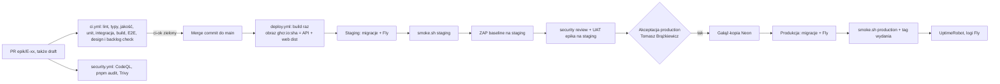

# Pipeline CI/CD

Ustalony z właścicielem 2026-10-26 (`/ci-cd`). Hosting i sekrety: `deployment.md`. Zasady pisania workflow: `.claude/skills/ci-cd/references/github-actions.md`. Git workflow: `tech-stack.md`.

## Przepływ

## Etapy

| # | Etap | Decyzja | Plik workflow | Wymagany check? |
| --- | --- | --- | --- | --- |
| 1 | Wyzwalacze, gałęzie, ochrona | CI na każdy PR (także draft) i push do `main`. Gałęzie: `epic/E-xx-<slug>`, `fix/T-NNN-<slug>`, `hotfix/T-NNN-<slug>`; merge commit; bez gałęzi per środowisko. Ochrona `main` (repo publiczne, ADR 0007): tylko przez PR, wymagany check `ci-ok`, bez force push i usuwania. Podglądów per PR brak (`deployment.md`) → security review i UAT na staging przed akceptacją produkcji | `ci.yml` | `ci-ok` |
| 2 | CI na PR | install z cache pnpm; Prettier check + ESLint; `tsc --noEmit` (strict); jakość: jscpd, reguły złożoności ESLint, dependency-cruiser (progi w `CODING_STANDARDS.md`); Vitest unit; integracja api na Testcontainers (Docker na `ubuntu-latest`); build wszystkich pakietów; Playwright + axe dla krytycznych ścieżek (api + web uruchomione w jobie, Postgres jako service container); Maestro na emulatorze Androida (lokalny build Gradle, bez zużywania limitu EAS) — tylko gdy zmieniły się `apps/mobile/**` lub `packages/shared/**`; sprawdzenie migracji na pustej bazie; `node scripts/backlog-check.mjs`; `node scripts/design-check.mjs --scan apps/web/src apps/mobile/src --allow generated`; raport pokrycia (artefakt, bez progu blokującego). Joby per warstwa (`dorny/paths-filter`), jeden check `ci-ok` | `ci.yml` | `ci-ok` |
| 3 | Bezpieczeństwo i łańcuch dostaw | CodeQL (JavaScript/TypeScript) na PR i co tydzień; GitHub secret scanning + push protection (włączone w ustawieniach); `pnpm audit --audit-level high` blokuje (próg: brak high/critical, TH-22); Dependabot dla npm i github-actions (co tydzień, grupowane); Trivy na obrazie API (blokuje high/critical z dostępną poprawką); ZAP baseline na staging po każdym wdrożeniu (reguły `.zap/rules.tsv`, FAIL dla nagłówków CSP/HSTS/Referrer-Policy); akcje przypięte do SHA; `permissions: contents: read` domyślnie; `SECURITY.md` + private vulnerability reporting. Pokrycie zagrożeń `ci` — tabela niżej | `security.yml`, `dependabot.yml`, `deploy.yml` (ZAP) | CodeQL i audit: tak (przez `ci-ok`: audit w `ci.yml`; CodeQL jako drugi wymagany check `codeql`) |
| 4 | Build raz, wdrażaj wiele razy | Na każdy commit `main`: jeden obraz `ghcr.io/tombraz/lista-zakupow:<sha>` (publiczny pakiet, bez sekretów) z API i zbudowanym `apps/web/dist` (Fastify serwuje oba pod jednym originem, ADR 0006). Ten sam obraz idzie na staging i produkcję; web używa względnych adresów (`/api/v1`, WebSocket na tym samym hoście), więc bundle nie ma konfiguracji per środowisko. Wyjątek: build mobile jest per profil EAS (adres API w buildzie), bo APK nie ma konfiguracji z serwera | `deploy.yml` | — |
| 5 | Migracje bazy | drizzle-kit `migrate` jako `release_command` Fly (przed startem nowej wersji; nieudana migracja = wdrożenie przerwane, stara wersja działa dalej). Tylko zmiany zgodne wstecz (expand/contract): nowa kolumna / tabela w jednym wydaniu, usunięcie starej w kolejnym. Przed migracją produkcji: gałąź-kopia Neon `pre-<sha>` (`neonctl branches create`), usuwana po 7 dniach | `deploy.yml` | — |
| 6 | Ciągłe dostarczanie | po merge do `main`: automatycznie staging (`scripts/deploy.sh staging <sha>`), `scripts/smoke.sh staging`, ZAP baseline. Produkcja: job w środowisku GitHub `production` z wymaganym akceptującym (Tomasz Brążkiewicz), czeka na akceptację po UAT epika; potem `deploy.sh production <sha>` i `smoke.sh production`. Concurrency per środowisko, bez anulowania wdrożeń w toku | `deploy.yml` | — |
| 7 | Mobile | profile EAS: `development` (lokalnie), `staging` i `production` (APK, internal distribution, adres API z profilu). Build `production` uruchamiany ręcznie (`workflow_dispatch`) po wdrożeniu API produkcji; link do APK wysyłany domownikom. iOS: tylko build na symulator w CI, bez dystrybucji (ADR 0008). EAS Update (OTA): nie w MVP — nowe wydanie = nowy APK; wrócić, jeśli instalacje będą uciążliwe. Wersja: `version` z `package.json`, `versionCode` automatycznie przez EAS (`autoIncrement`) | `mobile.yml` | — |
| 8 | Sekrety i dostęp | tabela w `deployment.md`. Sekrety w GitHub Environments `staging` / `production` i w sekretach Fly; tokeny o najwęższym zakresie (OIDC u Fly niezweryfikowane). Akceptujący produkcji: Tomasz Brążkiewicz. Lokalna blokada komend produkcyjnych — niżej | — | — |
| 9 | Wydania | po udanym wdrożeniu produkcji workflow tworzy tag `v<rok>.<miesiąc>.<dzień>-<sha7>` i GitHub Release z automatycznymi notatkami (lista PR). Bez semver i ręcznego changelogu (jeden autor, brak konsumentów API spoza monorepo) | `deploy.yml` (krok końcowy) | — |
| 10 | Wycofanie | tabela niżej | — | — |
| 11 | Po wdrożeniu | healthcheck Fly na `/health` (bez bazy); UptimeRobot co 5 min na `https://lista-prod.fly.dev/health` (proces API, który serwuje też web) z alarmem mailem do właściciela (N-03); `/health/ready` (z bazą) tylko w smoke teście, żeby baza Neon mogła usypiać; logi pino w Fly (retencja niezweryfikowana — sprawdzić w tasku); kopie: przywracanie do punktu w czasie Neon Launch 7 dni; test odtworzenia raz przed pilotażem (przywrócenie do gałęzi i sprawdzenie liczby list) | — | — |
| 12 | Koszty | alert / limit wydatków u Fly i Neon, jeśli dostępny (sprawdzić w tasku; inaczej comiesięczny przegląd rachunku przez właściciela); staging: Fly auto-stop + Neon Free; gałęzie-kopie Neon usuwane po 7 dniach. Brak środowisk podglądu do sprzątania | — | — |

## Joby CI per warstwa

| Warstwa | Uruchamiany, gdy zmienią się ścieżki | Joby (komendy z przewodnika warstwy) |
| --- | --- | --- |
| db | `apps/api/src/db/**`, `apps/api/drizzle/**` | sprawdzenie migracji na pustej bazie (service container Postgres) + integracja api |
| backend | `apps/api/**`, `packages/shared/**` | lint, typy, jakość, unit, integracja (Testcontainers), build obrazu (bez push), E2E web |
| web | `apps/web/**`, `packages/shared/**`, `packages/tokens/**`, `docs/design/tokens.json` | lint, typy, jakość, unit + komponenty, build, E2E web (Playwright + axe, web serwowany przez API jak na produkcji), design check |
| mobile | `apps/mobile/**`, `packages/shared/**`, `packages/tokens/**` | lint, typy, jakość, unit + komponenty, design check, E2E Android (Maestro), build iOS na symulator |
| infra | `.github/**`, `scripts/**`, `docker-compose.yml`, `Dockerfile`, `fly*.toml` | actionlint, testy skryptów (`--dry-run`); zmiana `.github/**` uruchamia wszystkie joby |
| zawsze | — | `pnpm audit --audit-level high`, `node scripts/backlog-check.mjs`, format check |

Zbiorczy wymagany check: `ci-ok` (przechodzi tylko, gdy każdy uruchomiony job przeszedł). Drugi wymagany check: `codeql`.

## Pokrycie zagrożeń `ci` (z `threat-model.md`)

| Zagrożenie | Kontrola w pipeline |
| --- | --- |
| TH-07 wyciek bazy / kopii | przegląd konfiguracji: Neon i Fly w UE, dostęp do bazy tylko z `DATABASE_URL` w sekretach Fly (TLS wymagany, `sslmode=require`), kopie u dostawcy; szyfrowanie danych w spoczynku u Neon do potwierdzenia w tasku staging |
| TH-15 XSS | ESLint `react/no-danger` w `ci.yml`; CSP z `@fastify/helmet`, test nagłówka w integracji i smoke teście; ZAP baseline na staging |
| TH-20 SQL injection | reguła ESLint zakazująca `sql.raw` z danymi + testy walidacji w `ci.yml`; CodeQL |
| TH-22 łańcuch dostaw | lockfile, `pnpm audit` blokuje high/critical, Dependabot, secret scanning + push protection, Trivy, akcje przypięte do SHA |
| TH-23 sekret w paczce mobile | secret scanning + push protection; w buildzie tylko publiczny adres API z profilu EAS |
| TH-24 transport | HSTS z `@fastify/helmet`, `force_https` w Fly; test nagłówków w smoke teście; ZAP baseline |

## Strategia migracji

Migracje SQL generowane przez drizzle-kit, w repo (`apps/api/drizzle/`). Wykonuje je `release_command` Fly przed przełączeniem ruchu na nową wersję. Każda migracja musi działać z poprzednią wersją API (expand/contract); usunięcie kolumny lub tabeli dopiero w wydaniu po tym, w którym kod przestał jej używać. Przed migracją produkcji powstaje gałąź-kopia Neon. Nieudana migracja przerywa wdrożenie; poprawka idzie nowym PR (bez ręcznych zmian na bazie produkcyjnej). CI sprawdza migracje na pustej bazie przy każdej zmianie `db`.

## Wycofanie

| Komponent | Jak | Czas docelowy |
| --- | --- | --- |
| API + web | `scripts/deploy.sh production <poprzedni-sha>` (ten sam obraz z GHCR) uruchamiany przez `workflow_dispatch` z akceptacją `production` | ≤ 15 min |
| Baza | bez cofania migracji (zgodne wstecz); przy uszkodzeniu danych: przywrócenie Neon do punktu w czasie lub z gałęzi-kopii `pre-<sha>` | ≤ 1 h |
| Mobile | ponowne wysłanie linku do poprzedniego APK z EAS | ≤ 1 dzień |

Nieudany smoke test po wdrożeniu staging zatrzymuje pipeline; nieudany smoke test produkcji uruchamia wycofanie obrazu do poprzedniego SHA. Wycofanie sprawdzone raz na staging (celowo zepsuty smoke test) w tasku wdrożenia produkcji.

## Monitoring i alarmy

- UptimeRobot (co 5 min): `lista-prod.fly.dev/health` → mail do właściciela przy awarii i powrocie.
- Healthcheck Fly (`/health`) restartuje maszynę API po awarii procesu.
- Logi API (pino, JSON, bez danych osobowych) w Fly; zdarzenia bezpieczeństwa z logiem `security` (`architecture.md`).
- Błędy 5xx przeglądane w logach Fly; bez zewnętrznego śledzenia błędów (N-02).

## Lokalna blokada komend produkcyjnych

Reguły **ask** w `.claude/settings.json` (żaden agent nie uruchomi ich bez potwierdzenia właściciela, w każdym trybie uprawnień; produkcja idzie przez pipeline z akceptacją):

- `Bash(fly deploy *)`, `Bash(flyctl deploy *)`, `Bash(fly secrets *)`, `Bash(flyctl secrets *)`, `Bash(fly apps *)`, `Bash(flyctl apps *)`, `Bash(fly machine *)`, `Bash(flyctl machine *)`, `Bash(fly scale *)`, `Bash(flyctl scale *)`, `Bash(fly releases *)`, `Bash(flyctl releases *)`
- `Bash(neonctl *)`, `Bash(npx neonctl *)`
- `Bash(drizzle-kit migrate *)`, `Bash(drizzle-kit push *)`, `Bash(pnpm drizzle-kit *)`, `Bash(npx drizzle-kit *)`, `Bash(pnpm db:migrate *)`
- `Bash(eas build *)`, `Bash(eas submit *)`, `Bash(eas update *)`, `Bash(npx eas-cli *)`
- `Bash(gh secret *)`, `Bash(gh variable *)`, `Bash(gh repo edit *)`, `Bash(gh api *)`

## Kandydaci na taski infra (dla `/plan-backlog`)

W kolejności zależności; każdy z tym, co da się pokazać.

1. **CI baseline** (część walking skeleton): `ci.yml` z paths-filter, lint, typy, jakość, unit, integracja, build, backlog i design check, `ci-ok`; skrypt `gh` do ochrony `main` i zmiany widoczności repo (uruchamia właściciel). Pokaz: zielony `ci-ok` na PR i czerwony na gałęzi z celowo zepsutym testem; merge zablokowany.
2. **Bezpieczeństwo:** `security.yml` (CodeQL, Trivy), `pnpm audit` w CI, `dependabot.yml`, secret scanning + push protection, `SECURITY.md`, reguły ESLint z TH-15 / TH-20. Pokaz: celowo podatna zależność blokuje PR; testowy sekret odrzucony przy push.
3. **Wdrożenie staging:** obraz (API + web) do GHCR, serwowanie SPA i nagłówki z Fastify, `deploy.sh` / `smoke.sh`, Fly `lista-staging`, Neon `lista-staging`, Brevo staging (zweryfikowany nadawca), ZAP baseline. Pokaz: merge do `main` wdraża staging, smoke i ZAP zielone, reset hasła dochodzi mailem (sprawdzić też folder spam).
4. **Wdrożenie produkcji:** środowisko `production` z akceptacją, gałąź-kopia Neon, migracje przez `release_command`, tag i Release, wycofanie. Pokaz: akceptacja → produkcja; celowo nieudany smoke na staging uruchamia wycofanie.
5. **Mobile:** `eas.json` (profile), `mobile.yml` (build `production` ręcznie), Maestro na emulatorze w CI, build iOS symulatora. Pokaz: APK z linku działa z API staging na telefonie domownika.
6. **Monitoring i kopie:** UptimeRobot (monitor `/health`, mail), alerty kosztowe Fly / Neon, test odtworzenia kopii Neon. Pokaz: wyłączona maszyna staging → mail; przywrócona gałąź ma te same listy.
7. **Wydania:** tag `v<data>-<sha7>` i Release z notatkami (może wejść do taska 4).

## Otwarte pytania

- [ ] Czy CodeQL jako osobny wymagany check (`codeql`) nie spowalnia PR za bardzo — ocenić po pierwszym epiku.
