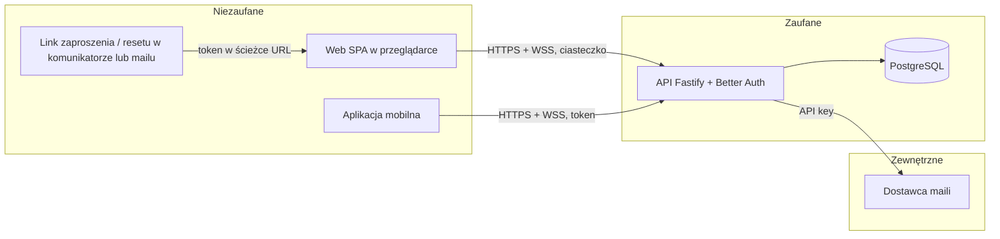

# Model zagrożeń

Lekki, per ścieżka i granica zaufania. Poziom **OWASP ASVS 5.0: 2** (wybór właściciela 2026-10-26): konta z prywatną treścią i dane osobowe innych osób (imię, e-mail uczestników). Kolumna „ASVS” podaje nazwę rozdziału; dokładne identyfikatory wymagań brać z oficjalnego dokumentu (github.com/OWASP/ASVS) przy pisaniu tasków, nie z pamięci.

## Zasoby i klasyfikacja danych

| Zasób / dane | Klasa | Gdzie | Kto ma dostęp |
| --- | --- | --- | --- |
| imię | personal | `user.name` | domownik; osoby na wspólnych listach |
| e-mail | personal | `user.email` | domownik; właściciel listy, na której jest uczestnikiem |
| hash hasła | sensitive (poświadczenie) | `account.password` | tylko API (Better Auth) |
| sesje, tokeny resetu | sensitive (poświadczenie) | `session`, `verification`; ciasteczko (web), SecureStore (mobile) | właściciel sesji; API |
| tokeny zaproszeń | sensitive (daje dostęp do listy) | `invitation.token` | właściciel listy; posiadacz linku |
| treść list i pozycji | personal (prywatne) | `shopping_list`, `item` | właściciel i uczestnicy |
| członkostwo, autor dodania / odhaczenia | personal | `list_member`, `item` | właściciel i uczestnicy |
| kopie bazy | jak wyżej (wszystko) | hosting | właściciel projektu |

## Aktorzy

| Aktor | Zaufanie | Uwagi |
| --- | --- | --- |
| anonimowy odwiedzający | brak | widzi tylko SC-01…SC-04 i podgląd zaproszenia z ważnym tokenem |
| zalogowany domownik | własne konto i listy, do których ma dostęp | |
| inny zalogowany domownik | brak dostępu do cudzych list | najczęstszy realny atakujący (MC-01) |
| uczestnik | pozycje listy; bez akcji właściciela | może stracić dostęp w trakcie (MC-03) |
| posiadacz przechwyconego linku | jednorazowy dostęp, jeśli link ważny | MC-02 |
| bot / spamer | brak | MC-05 |
| właściciel projektu (operator) | pełny dostęp do infrastruktury | brak ról administracyjnych w aplikacji |

## Granice zaufania

## Threats

| ID | Ścieżka / granica | STRIDE | Zagrożenie | P × wpływ | Mitygacja | Weryfikacja | Covered by | ASVS |
| --- | --- | --- | --- | --- | --- | --- | --- | --- |
| TH-01 | J-02, J-03, J-04 / API | E, I | **MC-01:** inny domownik czyta lub zmienia cudzą listę, pozycje, uczestników albo linki, podmieniając identyfikator | wysokie | `requireListAccess` przy każdej operacji, domyślnie odmowa, 404 bez zdradzania istnienia; zapytania zawsze z `list_id` | negatywne testy integracyjne każdej trasy listy (inny domownik, anonim) | task | Authorization |
| TH-02 | J-02, J-04 / API | E | uczestnik wykonuje akcje właściciela (zmiana nazwy, usunięcie listy, zaproszenia, usuwanie uczestników) | średnie | rola sprawdzana w `requireListAccess(…, "owner")` | testy integracyjne 403 dla uczestnika | task | Authorization |
| TH-03 | J-05 / WebSocket | E, I | subskrypcja cudzej listy przez WS z podmienionym `listId` | wysokie | sprawdzenie dostępu przy `subscribe` | test integracyjny WS: odmowa i brak zdarzeń | task | Authorization |
| TH-04 | J-04, J-05 / WebSocket | I, E | **MC-03:** usunięty lub odchodzący uczestnik dalej dostaje zdarzenia przez otwarte połączenie albo zmienia pozycje | wysokie | `revoke()` w tej samej operacji co usunięcie członkostwa, przed rozesłaniem kolejnego zdarzenia; zapisy zawsze sprawdzają dostęp w bazie | test integracyjny: po usunięciu kolejne zdarzenie nie dociera, zapis zwraca 404; E2E J-05 | task | Authorization |
| TH-05 | J-04 / API | S, E | **MC-02:** dołączenie wykorzystanym, wygasłym lub unieważnionym linkiem; dwie osoby jednocześnie jednym linkiem | wysokie | warunkowy `UPDATE` w jednej transakcji (nieużyty, nieunieważniony, `expires_at > now()`), 410 w pozostałych przypadkach | testy integracyjne: ponowne użycie, wygasły (zegar), unieważniony, dwa równoległe przyjęcia → jedno udane | task | Business Logic |
| TH-06 | J-04 / link | I, S | odgadnięcie tokenu zaproszenia | niskie | token 256 bit z CSPRNG, base64url; limit zapytań o zaproszenia per IP | test unit długości i źródła losowości; test 429 | task | Authorization |
| TH-07 | J-04 / baza | I | wyciek bazy lub kopii ujawnia jawne tokeny zaproszeń (ważne linki) | niskie | linki wygasają po 7 dniach; dostęp do bazy i kopii ograniczony, kopie szyfrowane u dostawcy; token jawny tylko dla właściciela listy (SC-07) | przegląd konfiguracji hostingu (`/ci-cd`) | ci | Data Protection |
| TH-08 | J-04 / link | I | token zaproszenia wycieka przez nagłówek `Referer` lub logi | średnie | `Referrer-Policy: no-referrer` na web; brak zasobów zewnętrznych; logi API redagują ścieżkę `/invitations/:token` | test nagłówków w CI; test redakcji logów | task | Data Protection |
| TH-09 | J-01 / API | S | **MC-04:** zgadywanie hasła (brute force, credential stuffing) | wysokie | limit prób logowania per IP (Better Auth `rateLimit`) i per konto (licznik nieudanych prób na e-mail); hasło ≥ 8 znaków; ogólny komunikat | testy integracyjne 429 dla IP i dla konta | task | Authentication |
| TH-10 | J-01 / API | S, D | **MC-04:** nadużycie resetu hasła (przejęcie, zalewanie skrzynki) | średnie | token Better Auth jednorazowy, 1 h; limit próśb per IP i per e-mail; ta sama odpowiedź dla istniejącego i nieistniejącego e-maila; reset unieważnia wszystkie sesje | testy integracyjne: użyty / wygasły token, 429, identyczna odpowiedź, sesje unieważnione | task | Authentication |
| TH-11 | J-01 / API | I | wyliczanie kont przez logowanie lub reset (komunikaty, czas odpowiedzi) | średnie | ten sam komunikat i kod; Better Auth wykonuje hash także dla nieistniejącego konta | test integracyjny identycznych odpowiedzi | task | Authentication |
| TH-12 | J-01 / API | I | wyliczanie kont przez rejestrację („e-mail już użyty”, wymóg F-01) | średnie | limit rejestracji per IP | test 429 | accepted | Authentication |
| TH-13 | J-01 / API | D | **MC-05:** masowe zakładanie kont i zapychanie danych | średnie | limit rejestracji per IP; limity biznesowe 50 / 500 / 20; limit tworzenia linków; limit rozmiaru treści żądania (Fastify `bodyLimit`) i wiadomości WS | testy integracyjne 429 i `limit_reached` | task | Business Logic |
| TH-14 | wszystkie / web | S, T | CSRF: obca strona wysyła żądanie z ciasteczkiem domownika; przejęcie WebSocket z obcego originu (CSWSH) | średnie | `SameSite=Lax`; sprawdzenie `Origin` (zaufane originy) dla żądań zmieniających stan i upgrade WS; brak zmian stanu przez `GET` | testy integracyjne: obcy `Origin` odrzucony dla POST i WS | task | Session Management |
| TH-15 | wszystkie / web | I, T | XSS przez nazwę listy, pozycji, notatkę lub imię (treść innych osób) | średnie | renderowanie przez React bez `dangerouslySetInnerHTML`; CSP bez `unsafe-inline` dla skryptów; walidacja długości | lint zakazujący `dangerouslySetInnerHTML`; test nagłówków CSP; skan DAST | ci | Encoding and Sanitization |
| TH-16 | wszystkie / web, mobile | I | kradzież sesji: token w `localStorage`, AsyncStorage, logach lub URL | średnie | web: ciasteczko `HttpOnly`, `Secure`; mobile: `expo-secure-store`; nigdy token w URL (także WS); redakcja logów | przegląd w QA; test, że WS nie przyjmuje tokenu z query | task | Session Management |
| TH-17 | J-01 / API | S | sesja nie wygasa lub działa po wylogowaniu / usunięciu konta | średnie | sesje w bazie, wygasanie 30 dni, wylogowanie usuwa sesję i zamyka WS, usunięcie konta kasuje sesje | testy integracyjne: po wylogowaniu 401 i zamknięte WS | task | Session Management |
| TH-18 | J-01 / API | I | usunięcie konta zostawia dane (listy, sesje) albo usuwa cudze pozycje | średnie | jedna transakcja usunięcia wg `data-model.md` (kaskady i `SET NULL`) | test integracyjny F-04 | task | Data Protection |
| TH-19 | J-02 / API | I | e-mail uczestników widoczny dla innych uczestników (F-13) albo przy pozycjach (F-10) | średnie | e-mail tylko w odpowiedzi `members` dla właściciela; `Item` zawiera tylko `id` i `name` autora | test integracyjny kształtu odpowiedzi dla uczestnika | task | Data Protection |
| TH-20 | wszystkie / API | T | wstrzyknięcie SQL, niepoprawne dane wejściowe | niskie | Drizzle z parametrami, zakaz SQL składanego z tekstu; zod na każdej trasie | lint (zakaz `sql.raw` z danymi), testy walidacji | ci | Validation and Business Logic |
| TH-21 | wszystkie / logi | I, R | dane osobowe lub sekrety w logach; brak śladu zdarzeń bezpieczeństwa | średnie | redakcja pino; log `security` z identyfikatorami | test redakcji; przegląd logów w QA | task | Security Logging |
| TH-22 | łańcuch dostaw | T, E | podatna lub złośliwa zależność; sekret w repozytorium | średnie | lockfile w repo; skan zależności (blokuje high/critical) i sekretów w CI; Dependabot / Renovate | kroki w `pipeline.md` | ci | Configuration |
| TH-23 | mobile | I | sekret w paczce aplikacji; logi debug w buildzie | niskie | aplikacja zawiera tylko publiczny adres API; brak kluczy; build bez logów debug | skan sekretów w CI; przegląd w QA | ci | Configuration |
| TH-24 | wszystkie / transport | I, T | podsłuch lub modyfikacja ruchu | niskie | HTTPS i WSS wszędzie, HSTS na web; bez ruchu czystym HTTP na produkcji | test nagłówków w CI; DAST | ci | Secure Communication |
| TH-25 | J-05 / WebSocket | D | zalewanie serwera połączeniami lub wiadomościami WS | niskie | połączenie tylko z ważną sesją; limit połączeń na sesję i wiadomości na sekundę; limit rozmiaru wiadomości | test integracyjny limitów WS | task | Business Logic |
| TH-26 | wszystkie / API | S, T | kontrola bezpieczeństwa w hooku (np. `Origin`, redakcja) działa na innej postaci ścieżki niż router, więc część żądań do chronionej trasy ją omija | średnie | decyzje na dopasowanej trasie (`request.routeOptions.url`) albo dla każdej metody zmieniającej stan; nigdy na prefiksie surowego `request.url` | testy integracyjne wariantów zapisu ścieżki dla każdego chronionego prefiksu | task | Configuration |
| TH-27 | J-01 / API, baza | D | **MC-05:** zapychanie bazy zapisami bez uwierzytelnienia, które dzieją się przed limitem (`sign_in_failure`, przyszłe tabele przed logowaniem) | średnie | limit per IP przed pierwszym zapisem; retencja wg `data-model.md` | test: po przekroczeniu limitu liczba wierszy się nie zmienia | task | Business Logic |
| TH-28 | J-05 / WebSocket | I, S | połączenie WS żyje po końcu sesji innym niż wylogowanie (wygaśnięcie, usunięcie sesji, reset hasła, usunięcie konta) | średnie | `closeSession` na każdej ścieżce końca sesji; ponowna kontrola sesji przy `subscribe` i okresowo | test: usunięcie sesji zamyka gniazdo, kolejny `subscribe` odrzucony | task | Session Management |
| TH-29 | wszystkie / web | S | podszywanie się przez znaki bidi, sterujące i zero-width w imionach i nazwach widocznych dla innych (SC-08, wspólne listy); obejście blokady duplikatu (F-09) | niskie | odrzucanie Cc/Cf i znaków bidi, wymóg widocznego znaku; NFKC i usuwanie znaków ignorowalnych w normalizacji duplikatu | testy walidacji dla każdej klasy znaków | task | Validation and Business Logic |

## Decyzje bazowe bezpieczeństwa

| Temat | Decyzja | ADR |
| --- | --- | --- |
| Uwierzytelnianie | Better Auth, e-mail + hasło; żadnej własnej kryptografii ani obsługi haseł | 0002 |
| Przechowywanie haseł | domyślny algorytm Better Auth (scrypt), parametry biblioteki; minimum 8 znaków (BRD) | 0002 |
| Sesja (web) | sesja w bazie, ciasteczko `HttpOnly`, `Secure`, `SameSite=Lax`, wygasanie 30 dni bez użycia; web i API pod jednym originem (ADR 0006) | 0002 |
| Token (mobile) | token sesji w `expo-secure-store` (Keychain / Keystore) przez plugin Expo Better Auth | 0002 |
| Model autoryzacji | jedna funkcja `requireListAccess` w module `listy`, domyślnie odmowa, 404 dla braku dostępu; WS sprawdza dostęp przy subskrypcji i jest odwoływany przy utracie dostępu | 0003 |
| Walidacja wejścia i kodowanie wyjścia | zod na serwerze dla każdej trasy i wiadomości WS; React / RN kodują wyjście; zakaz `dangerouslySetInnerHTML` | — |
| Limity i ochrona przed nadużyciami | Better Auth `rateLimit` (przechowywany w bazie) dla logowania, rejestracji, resetu; licznik nieudanych logowań per konto; `@fastify/rate-limit` dla zaproszeń; limity WS; `bodyLimit` 16 kB; limity biznesowe z BRD; konkretne progi w tasku | — |
| Nagłówki, CORS | `@fastify/helmet` dla wszystkich odpowiedzi (API i pliki web, ten sam origin): CSP, HSTS, `X-Content-Type-Options`, `frame-ancestors 'none'`, `Referrer-Policy: no-referrer`; CORS wyłączony (brak innych originów; aplikacja mobilna nie podlega CORS), nigdy `*` | — |
| Sekrety | lokalnie `.env` (ignorowany przez git; reguła odmowy odczytu `.env` w `.claude/settings.json` do dodania — plik jeszcze nie istnieje); CI i runtime: sekrety platformy (`/ci-cd`); aplikacja mobilna bez sekretów | — |
| Logi i ślad zdarzeń | pino JSON z redakcją; log `security` dla zdarzeń z `architecture.md`, tylko identyfikatory | — |
| Polityka zależności | lockfile w repo; skan w CI blokuje high/critical; aktualizacje automatycznymi PR co tydzień (narzędzie w `/ci-cd`) | — |
| Szyfrowanie | TLS w tranzycie (HTTPS, WSS, połączenie z bazą); w spoczynku — szyfrowanie dysku i kopii zarządzanej bazy u dostawcy (`/ci-cd`) | — |

## Zaakceptowane ryzyka

| Zagrożenie | Powód | Zaakceptował / data | Wrócić |
| --- | --- | --- | --- |
| TH-12 wyliczanie kont przez rejestrację | BRD F-01 wymaga komunikatu „e-mail już użyty”; ogólny komunikat wymagałby potwierdzania e-maila (dodatkowy mail). Limit rejestracji per IP utrudnia masowe sprawdzanie | Tomasz Brążkiewicz, 2026-10-26 | przed udostępnieniem aplikacji poza domownikami (razem z R-05) |

## Profesjonalny przegląd

Domena nie jest wysokiego ryzyka (BRD §8b): bez płatności, danych zdrowotnych ani kategorii szczególnych. Zewnętrzny audyt ani test penetracyjny nie jest planowany. Ten proces (model zagrożeń, testy negatywne, `/security-review`) nie zastępuje profesjonalnego przeglądu; wrócić do tematu, jeśli aplikacja zostanie udostępniona szerzej.

## Historia zmian

| Data | Zmiana |
| --- | --- |
| 2026-10-31 | `/security-review E-01`: dodane TH-26 (rozjazd ścieżki w kontrolach), TH-27 (zapisy przed limitem), TH-28 (WS po końcu sesji), TH-29 (podszywanie Unicode); `docs/security/reviews/E-01-2026-10-31-1.md`. |
| 2026-10-26 | `/ci-cd`: bez własnej domeny — web serwowany przez API pod jednym originem, CORS wyłączony (ADR 0006). |
| 2026-10-26 | `/plan-backlog`: nagłówek sekcji zagrożeń i kolumna pokrycia przywrócone do etykiet z szablonu (`## Threats`, `Covered by`), które czyta `scripts/backlog-check.mjs`; treść bez zmian. |
