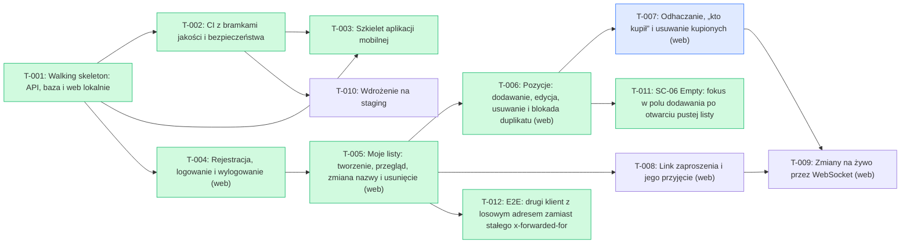

# Backlog index

> Generated by `node scripts/backlog-check.mjs --write-index`. Do not edit by hand.

**Status:** 8 done · 1 in QA · 0 in progress · 3 todo · 0 blocked

## Ready to start

- T-008 — Link zaproszenia i jego przyjęcie (web)
- T-010 — Wdrożenie na staging

## Waiting for QA

- T-007 — Odhaczanie, „kto kupił” i usuwanie kupionych (web)

## Dependency graph

## All tasks

| Task | Title | Epic | Story | Status | Depends on |
| --- | --- | --- | --- | --- | --- |
| [T-001](E-01-szkielet-i-wspolna-lista/S-01-01-szkielet/T-001-walking-skeleton.md) | Walking skeleton: API, baza i web lokalnie | E-01 | S-01-01 | done | — |
| [T-002](E-01-szkielet-i-wspolna-lista/S-01-01-szkielet/T-002-ci-bramki.md) | CI z bramkami jakości i bezpieczeństwa | E-01 | S-01-01 | done | T-001 |
| [T-003](E-01-szkielet-i-wspolna-lista/S-01-01-szkielet/T-003-szkielet-mobile.md) | Szkielet aplikacji mobilnej | E-01 | S-01-01 | done | T-001, T-002 |
| [T-004](E-01-szkielet-i-wspolna-lista/S-01-02-konto-i-logowanie/T-004-rejestracja-i-logowanie.md) | Rejestracja, logowanie i wylogowanie (web) | E-01 | S-01-02 | done | T-001 |
| [T-005](E-01-szkielet-i-wspolna-lista/S-01-03-moje-listy/T-005-moje-listy.md) | Moje listy: tworzenie, przegląd, zmiana nazwy i usunięcie (web) | E-01 | S-01-03 | done | T-004 |
| [T-006](E-01-szkielet-i-wspolna-lista/S-01-04-pozycje/T-006-pozycje.md) | Pozycje: dodawanie, edycja, usuwanie i blokada duplikatu (web) | E-01 | S-01-04 | done | T-005 |
| [T-007](E-01-szkielet-i-wspolna-lista/S-01-04-pozycje/T-007-odhaczanie.md) | Odhaczanie, „kto kupił” i usuwanie kupionych (web) | E-01 | S-01-04 | in-qa | T-006 |
| [T-008](E-01-szkielet-i-wspolna-lista/S-01-05-udostepnienie/T-008-zaproszenia.md) | Link zaproszenia i jego przyjęcie (web) | E-01 | S-01-05 | todo | T-005 |
| [T-009](E-01-szkielet-i-wspolna-lista/S-01-06-na-zywo/T-009-zmiany-na-zywo.md) | Zmiany na żywo przez WebSocket (web) | E-01 | S-01-06 | todo | T-007, T-008 |
| [T-010](E-01-szkielet-i-wspolna-lista/S-01-01-szkielet/T-010-staging.md) | Wdrożenie na staging | E-01 | S-01-01 | todo | T-002 |
| [T-011](fixes/T-011-fokus-pusta-lista.md) | SC-06 Empty: fokus w polu dodawania po otwarciu pustej listy | undefined | undefined | done | T-006 |
| [T-012](fixes/T-012-e2e-staly-adres-klienta.md) | E2E: drugi klient z losowym adresem zamiast stałego x-forwarded-for | undefined | undefined | done | T-005 |
