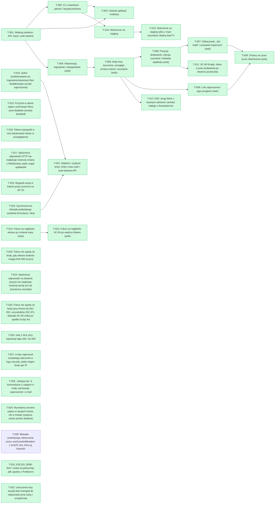

# Backlog index

> Generated by `node scripts/backlog-check.mjs --write-index`. Do not edit by hand.

**Status:** 31 done · 0 in QA · 0 in progress · 1 todo · 0 blocked

## Ready to start

- T-030 — Blokada podwójnego odhaczenia przez useGuardedMutation z lockOf; test, który ją dowodzi

## Waiting for QA

_Nothing waiting._

## Dependency graph

## All tasks

| Task | Title | Epic | Story | Status | Depends on |
| --- | --- | --- | --- | --- | --- |
| [T-001](E-01-szkielet-i-wspolna-lista/S-01-01-szkielet/T-001-walking-skeleton.md) | Walking skeleton: API, baza i web lokalnie | E-01 | S-01-01 | done | — |
| [T-002](E-01-szkielet-i-wspolna-lista/S-01-01-szkielet/T-002-ci-bramki.md) | CI z bramkami jakości i bezpieczeństwa | E-01 | S-01-01 | done | T-001 |
| [T-003](E-01-szkielet-i-wspolna-lista/S-01-01-szkielet/T-003-szkielet-mobile.md) | Szkielet aplikacji mobilnej | E-01 | S-01-01 | done | T-001, T-002 |
| [T-004](E-01-szkielet-i-wspolna-lista/S-01-02-konto-i-logowanie/T-004-rejestracja-i-logowanie.md) | Rejestracja, logowanie i wylogowanie (web) | E-01 | S-01-02 | done | T-001 |
| [T-005](E-01-szkielet-i-wspolna-lista/S-01-03-moje-listy/T-005-moje-listy.md) | Moje listy: tworzenie, przegląd, zmiana nazwy i usunięcie (web) | E-01 | S-01-03 | done | T-004 |
| [T-006](E-01-szkielet-i-wspolna-lista/S-01-04-pozycje/T-006-pozycje.md) | Pozycje: dodawanie, edycja, usuwanie i blokada duplikatu (web) | E-01 | S-01-04 | done | T-005 |
| [T-007](E-01-szkielet-i-wspolna-lista/S-01-04-pozycje/T-007-odhaczanie.md) | Odhaczanie, „kto kupił” i usuwanie kupionych (web) | E-01 | S-01-04 | done | T-006 |
| [T-008](E-01-szkielet-i-wspolna-lista/S-01-05-udostepnienie/T-008-zaproszenia.md) | Link zaproszenia i jego przyjęcie (web) | E-01 | S-01-05 | done | T-005 |
| [T-009](E-01-szkielet-i-wspolna-lista/S-01-06-na-zywo/T-009-zmiany-na-zywo.md) | Zmiany na żywo przez WebSocket (web) | E-01 | S-01-06 | done | T-007, T-008 |
| [T-010](E-01-szkielet-i-wspolna-lista/S-01-01-szkielet/T-010-staging.md) | Wdrożenie na staging | E-01 | S-01-01 | done | T-002 |
| [T-011](fixes/T-011-fokus-pusta-lista.md) | SC-06 Empty: fokus w polu dodawania po otwarciu pustej listy | undefined | undefined | done | T-006 |
| [T-012](fixes/T-012-e2e-staly-adres-klienta.md) | E2E: drugi klient z losowym adresem zamiast stałego x-forwarded-for | undefined | undefined | done | T-005 |
| [T-013](fixes/T-013-deploy-staging-tylko-z-main.md) | Wdrożenie na staging tylko z main (usunięcie deploy-test/**) | undefined | undefined | done | T-010 |
| [T-014](fixes/T-014-fokus-przy-zmianie-trasy.md) | Fokus na nagłówku ekranu po zmianie trasy (web) | undefined | undefined | done | — |
| [T-015](fixes/T-015-przycisk-loading-bez-disabled.md) | Przycisk w stanie zapisu zachowuje fokus (aria-disabled zamiast disabled) | undefined | undefined | done | — |
| [T-016](fixes/T-016-typografia-w-rem.md) | Tokeny typografii w rem (skalowanie tekstu w przeglądarce) | undefined | undefined | done | — |
| [T-017](fixes/T-017-starsza-odpowiedz-http-nie-nadpisuje.md) | Spóźniona odpowiedź HTTP nie nadpisuje nowszej zmiany z WebSocket; jeden zegar updatedAt | undefined | undefined | done | — |
| [T-018](fixes/T-018-wygasla-sesja-na-sc-01.md) | Wygasła sesja w trakcie pracy przenosi na SC-01 | undefined | undefined | done | — |
| [T-019](fixes/T-019-jedno-przekierowanie-po-wejsciu.md) | Jedno przekierowanie po logowaniu/rejestracji (bez dodatkowego accept zaproszenia) | undefined | undefined | done | — |
| [T-020](fixes/T-020-blokada-podwojnego-wyslania.md) | Synchroniczna blokada podwójnego wysłania formularzy i akcji | undefined | undefined | done | — |
| [T-021](fixes/T-021-kondycja-testow.md) | Stabilne i szybsze testy: limity czasu web i pula testowa API | undefined | undefined | done | T-019, T-020 |
| [T-022](fixes/T-022-fokus-sc-04-po-wejsciu.md) | Fokus na nagłówku SC-04 po wejściu linkiem (web) | undefined | undefined | done | T-014 |
| [T-023](fixes/T-023-fokus-po-limicie-pozycji.md) | Fokus nie spada na body, gdy własne dodanie osiąga limit 500 pozycji | undefined | undefined | done | — |
| [T-024](fixes/T-024-dodanie-pozycji-tylko-nowsza-wersja.md) | Spóźniona odpowiedź na dodanie pozycji nie nadpisuje nowszej wersji ani nie przywraca usuniętej | undefined | undefined | done | — |
| [T-025](fixes/T-025-fokus-przy-limicie-list-i-uczestnikow.md) | Fokus nie spada na body przy limicie list (SC-05) i uczestników (SC-07); blokada SC-05 znika po spadku liczby list | undefined | undefined | done | — |
| [T-026](fixes/T-026-nul-w-imieniu-przy-rejestracji.md) | Imię z NUL przy rejestracji daje 400, nie 500 | undefined | undefined | done | — |
| [T-027](fixes/T-027-log-security-limitow-zaproszen.md) | Limity zaproszeń zostawiają zdarzenie w logu security; jeden helper limitu per IP | undefined | undefined | done | — |
| [T-028](fixes/T-028-zaloguj-sie-przy-zajetym-emailu-z-zaproszeniem.md) | „Zaloguj się” w komunikacie o zajętym e-mailu zachowuje zaproszenie i e-mail | undefined | undefined | done | — |
| [T-029](fixes/T-029-rownolegle-dodawanie-pozycji.md) | Wywołania zwrotne zapisu w opcjach hooka, nie w mutate (uśpiona utrata wyniku dodania) | undefined | undefined | done | — |
| [T-030](fixes/T-030-blokada-odhaczenia-synchroniczna.md) | Blokada podwójnego odhaczenia przez useGuardedMutation z lockOf; test, który ją dowodzi | undefined | undefined | todo | — |
| [T-031](fixes/T-031-j03-500-pozycji-stabilny.md) | E2E j03 „500th item” czeka na pełną listę; plik zgodny z Prettierem | undefined | undefined | done | — |
| [T-032](fixes/T-032-lists-changed-po-utworzeniu-listy.md) | Utworzenie listy wysyła lists.changed do właściciela (inne karty i urządzenia) | undefined | undefined | done | — |
