# Backlog index

> Generated by `node scripts/backlog-check.mjs --write-index`. Do not edit by hand.

**Status:** 110 done · 0 in QA · 0 in progress · 11 todo · 1 blocked

## Ready to start

- T-052 — CI: błędy 57P01 przy usuwaniu bazy testowej po items.limit.test.ts
- T-066 — SC-06: pusty nagłówek h1 podczas ładowania i przy błędzie
- T-067 — SC-05: karta pustej listy pokazuje „Wszystko kupione”
- T-068 — CodeQL: alert js/missing-rate-limiting w pliku testowym
- T-084 — Niestabilny test SC-07 „Usuń” bez połączenia w ParticipantsScreen.remove.test.tsx
- T-090 — Testy na żywo: „brak zdarzenia” sprawdzany po sygnale zamiast 300 ms ciszy
- T-091 — Testy pingu, limitów połączeń i Brevo: sygnał zamiast pauzy i „still open” po czasie
- T-093 — CI: `ci-ok` przepuszcza job porzucony przez GitHub (`abandoned`)
- T-120 — Prośby o reset nie wyczerpują dobowego limitu maili dostawcy
- T-121 — Imiona, nazwy i notatki bez separatorów linii, nietypowych odstępów i pustych znaków

## Waiting for QA

_Nothing waiting._

## Dependency graph

```mermaid
flowchart LR
  T_001["T-001: Walking skeleton: API, baza i web lokalnie"]:::done
  T_002["T-002: CI z bramkami jakości i bezpieczeństwa"]:::done
  T_003["T-003: Szkielet aplikacji mobilnej"]:::done
  T_004["T-004: Rejestracja, logowanie i wylogowanie (web)"]:::done
  T_005["T-005: Moje listy: tworzenie, przegląd, zmiana nazwy i usunięcie (web)"]:::done
  T_006["T-006: Pozycje: dodawanie, edycja, usuwanie i blokada duplikatu (web)"]:::done
  T_007["T-007: Odhaczanie, „kto kupił” i usuwanie kupionych (web)"]:::done
  T_008["T-008: Link zaproszenia i jego przyjęcie (web)"]:::done
  T_009["T-009: Zmiany na żywo przez WebSocket (web)"]:::done
  T_010["T-010: Wdrożenie na staging"]:::done
  T_011["T-011: SC-06 Empty: fokus w polu dodawania po otwarciu pustej listy"]:::done
  T_012["T-012: E2E: drugi klient z losowym adresem zamiast stałego x-forwarded-for"]:::done
  T_013["T-013: Wdrożenie na staging tylko z main (usunięcie deploy-test/**)"]:::done
  T_014["T-014: Fokus na nagłówku ekranu po zmianie trasy (web)"]:::done
  T_015["T-015: Przycisk w stanie zapisu zachowuje fokus (aria-disabled zamiast disabled)"]:::done
  T_016["T-016: Tokeny typografii w rem (skalowanie tekstu w przeglądarce)"]:::done
  T_017["T-017: Spóźniona odpowiedź HTTP nie nadpisuje nowszej zmiany z WebSocket; jeden zegar updatedAt"]:::done
  T_018["T-018: Wygasła sesja w trakcie pracy przenosi na SC-01"]:::done
  T_019["T-019: Jedno przekierowanie po logowaniu/rejestracji (bez dodatkowego accept zaproszenia)"]:::done
  T_020["T-020: Synchroniczna blokada podwójnego wysłania formularzy i akcji"]:::done
  T_021["T-021: Stabilne i szybsze testy: limity czasu web i pula testowa API"]:::done
  T_022["T-022: Fokus na nagłówku SC-04 po wejściu linkiem (web)"]:::done
  T_023["T-023: Fokus nie spada na body, gdy własne dodanie osiąga limit 500 pozycji"]:::done
  T_024["T-024: Spóźniona odpowiedź na dodanie pozycji nie nadpisuje nowszej wersji ani nie przywraca usuniętej"]:::done
  T_025["T-025: Fokus nie spada na body przy limicie list (SC-05) i uczestników (SC-07); blokada SC-05 znika po spadku liczby list"]:::done
  T_026["T-026: Imię z NUL przy rejestracji daje 400, nie 500"]:::done
  T_027["T-027: Limity zaproszeń zostawiają zdarzenie w logu security; jeden helper limitu per IP"]:::done
  T_028["T-028: „Zaloguj się” w komunikacie o zajętym e-mailu zachowuje zaproszenie i e-mail"]:::done
  T_029["T-029: Wywołania zwrotne zapisu w opcjach hooka, nie w mutate (uśpiona utrata wyniku dodania)"]:::done
  T_030["T-030: Blokada podwójnego odhaczenia przez useGuardedMutation z lockOf; test, który ją dowodzi"]:::done
  T_031["T-031: E2E j03 „500th item” czeka na pełną listę; plik zgodny z Prettierem"]:::done
  T_032["T-032: Utworzenie listy wysyła lists.changed do właściciela (inne karty i urządzenia)"]:::done
  T_033["T-033: Limity WebSocket zostawiają zdarzenie w logu security; limit linku z userId"]:::done
  T_034["T-034: Test: każdy limit nadużyć ma sprawdzone zdarzenie w logu security (także 413)"]:::done
  T_035["T-035: Jeden schemat zdarzenia limitu w logu security: zawsze `limit` (klucz) i `route`"]:::done
  T_036["T-036: Niestabilny test: zwolnienie slotu połączenia na żywo po zamknięciu"]:::done
  T_037["T-037: Gniazda WS w trakcie zamykania bez limitu na sesję"]:::done
  T_038["T-038: Próby połączenia WS ponad limit zalewają log security"]:::done
  T_039["T-039: Fokus spada na body po szybkim odhaczeniu dwóch sąsiednich pozycji"]:::done
  T_040["T-040: Odpowiedzi 429 w HTTP zalewają log security"]:::done
  T_041["T-041: Spójne zdarzenia logu security: userId przy limicie linków, każdy limit WS osobno, jeden kształt `route`"]:::done
  T_042["T-042: SC-05: ostrzeżenie limitu w pustym stanie i wygasanie odmowy 409 po liczbie list"]:::done
  T_043["T-043: Jeden useLimitFocus w SC-06; stan zapisu na klucz z useGuardedMutation (SC-06, SC-07)"]:::done
  T_044["T-044: Wszystkie stałe limitów przypięte liczbą; reguły lintu z przeglądów bez wyłączania komentarzem"]:::done
  T_045["T-045: Reguł lintu nie wyłącza komentarz konfiguracyjny `/* eslint … */`"]:::done
  T_046["T-046: Stały test przebiegu lintu komentarzy (`eslint.directives.config.js`) na obejściach z T-045"]:::done
  T_047["T-047: Niestabilne testy ekranów web pod obciążeniem pełnego `pnpm test`"]:::blocked
  T_048["T-048: Logowanie: limit per IP przed zapisem licznika nieudanych prób"]:::done
  T_049["T-049: Sprawdzenie Origin obejmuje każde żądanie zmieniające stan w /api/v1"]:::done
  T_050["T-050: Testy weryfikujące TH-15, TH-16, TH-19, TH-21: logi treści, fixtures lintu, brak e-maila, Secure"]:::done
  T_051["T-051: Redakcja tokenu zaproszenia w logu obejmuje każdy zapis ścieżki"]:::done
  T_052["T-052: CI: błędy 57P01 przy usuwaniu bazy testowej po items.limit.test.ts"]
  T_053["T-053: Prośba o link resetu: mail z linkiem (lokalnie, Mailpit)"]:::done
  T_054["T-054: Nowe hasło z linku; reset kończy wszystkie sesje"]:::done
  T_055["T-055: Mail resetu przez Brevo na staging"]:::done
  T_056["T-056: Na żywo: subskrypcja nie wyprzedza odebrania dostępu; sesja sprawdzana przy subskrypcji i okresowo"]:::done
  T_057["T-057: Uczestnicy na SC-07: podgląd, e-maile tylko dla właściciela"]:::done
  T_058["T-058: Usunięcie uczestnika przez właściciela"]:::done
  T_059["T-059: Opuszczenie listy przez uczestnika"]:::done
  T_060["T-060: Tekst widoczny dla innych bez znaków sterujących i bidi; duplikat po NFKC"]:::done
  T_061["T-061: Zmiana imienia (SC-09)"]:::done
  T_062["T-062: Usunięcie konta (SC-09)"]:::done
  T_063["T-063: Pasek „Brak połączenia”, blokada zapisów i aktualny stan po powrocie"]:::done
  T_064["T-064: Codzienne sprzątanie danych w procesie API"]:::done
  T_065["T-065: Zapytania miar sukcesu (metrics.sql)"]:::done
  T_066["T-066: SC-06: pusty nagłówek h1 podczas ładowania i przy błędzie"]
  T_067["T-067: SC-05: karta pustej listy pokazuje „Wszystko kupione”"]
  T_068["T-068: CodeQL: alert js/missing-rate-limiting w pliku testowym"]
  T_069["T-069: Weryfikacja maila resetu przez Brevo na staging"]:::done
  T_070["T-070: Inwentarz tras i WS: NUL w każdym parametrze i polu tekstowym daje 4xx, nigdy 500"]:::done
  T_071["T-071: SC-03 i SC-01: komunikaty sukcesu ogłaszane czytnikowi ekranu (stały region status)"]:::done
  T_072["T-072: SC-09: 401 przy usuwaniu konta to sukces tylko po utraconej odpowiedzi"]:::done
  T_073["T-073: TH-29: ukryty tekst ze znaków tagów po 🏴 przechodzi walidację nazw"]:::done
  T_074["T-074: listy: jedna funkcja zdarzeń na żywo przy utracie dostępu i zmianie członkostwa (TH-04)"]:::done
  T_075["T-075: Reset hasła: udany reset unieważnia pozostałe linki resetu konta"]:::done
  T_076["T-076: PATCH /api/v1/me: błąd rozesłania zdarzeń nie zamienia zapisanego imienia w 500; 401 w api.md"]:::done
  T_077["T-077: Usunięcie uczestnika: zdarzenie member_removed w logu i 204 niezależnie od rozesłania zdarzeń"]:::done
  T_078["T-078: SC-01: „Konto zostało usunięte.” pokazane raz, nie przy każdym późniejszym przekierowaniu"]:::done
  T_079["T-079: SC-07: błąd usunięcia uczestnika pokazuje tekst według kodu błędu"]:::done
  T_080["T-080: Copy E-02 w specyfikacjach ekranów: dopisać zatwierdzone teksty, zatwierdzić brakujące"]:::done
  T_081["T-081: Dokumentacja architektury i API zgodna z kodem po E-02"]:::done
  T_082["T-082: Testy API E-02: czekanie na sygnał zamiast stałej pauzy przed asercją"]:::done
  T_083["T-083: Niestabilny test SC-07 „after a silent drop” w connection.test.tsx"]:::done
  T_084["T-084: Niestabilny test SC-07 „Usuń” bez połączenia w ParticipantsScreen.remove.test.tsx"]
  T_085["T-085: Test izolacji bazy testowej niezależny od kolejności testów"]:::done
  T_086["T-086: Błędy klienta z Fastify (zły JSON, za długi parametr) w formacie błędu API"]:::done
  T_087["T-087: Reset hasła: błąd unieważnienia pozostałych linków nie pomija zamknięcia połączeń i logu"]:::done
  T_088["T-088: Alert mailem do właściciela, gdy reset nie unieważni pozostałych linków"]:::done
  T_089["T-089: Zdarzenia na żywo po zapisie: błąd rozesłania nie daje 500 w żadnej trasie; reguła lintu"]:::done
  T_090["T-090: Testy na żywo: „brak zdarzenia” sprawdzany po sygnale zamiast 300 ms ciszy"]
  T_091["T-091: Testy pingu, limitów połączeń i Brevo: sygnał zamiast pauzy i „still open” po czasie"]
  T_092["T-092: Lint: zakaz stałej pauzy przed asercją w testach API i web"]
  T_093["T-093: CI: `ci-ok` przepuszcza job porzucony przez GitHub (`abandoned`)"]
  T_094["T-094: SC-06: uczestnik ma ikonę „Uczestnicy” i „Opuść listę” w menu"]:::done
  T_095["T-095: architecture.md i api.md zgodne z kodem; test zgodności ErrorCode"]:::done
  T_096["T-096: Copy SC-09 i SC-03 dla brakujących tekstów; UAT E-02 aktualny"]:::done
  T_097["T-097: SC-07: zamknięcie okna i fokus po zniknięciu osoby w efekcie, nie w renderze"]:::done
  T_098["T-098: API: jeden kształt logu dla błędów po zapisie i w tle (event + err)"]:::done
  T_099["T-099: backlog-check: praca przekazana „to E-xx” musi mieć task albo wpis w epiku"]:::done
  T_100["T-100: Test zgodności tekstów ekranów web z tabelami Copy; uzupełnienie Copy SC-01–SC-09"]:::done
  T_101["T-101: API: reguła eslint — `log.error` tylko w `logging.ts` i handlerze błędów; poprawki dokumentów po T-098"]:::done
  T_102["T-102: backlog-check: przekazanie z małymi literami (`to e-02`) liczone jak `to E-02`"]:::done
  T_103["T-103: Teksty okna „Opuść listę” w pliku komunikatów i w Copy SC-06/SC-07; test Copy łapie teksty w .tsx"]:::done
  T_104["T-104: SC-06: „Usuń listę” w menu nieaktywne bez połączenia, jak inne wyzwalacze akcji destrukcyjnych"]:::done
  T_105["T-105: Dokumentacja po przeglądzie 3 E-02: jedna tabela błędów, listId w formacie błędu, backend.md, UAT.md i ślad AC"]:::done
  T_106["T-106: Teksty komponentów design systemu (`components/*.tsx`) w plikach komunikatów i w rejestrze Copy"]:::done
  T_107["T-107: Test Copy: jednowyrazowe teksty w atrybutach JSX (`aria-label`, `title`, `alt`, `placeholder`) w `.tsx` modułu wspólnego"]:::done
  T_108["T-108: Wiersz Copy SC-01 `legal` po przeniesieniu tekstu do Copy komponentów; wykrywanie wierszy Copy bez kodu"]:::done
  T_109["T-109: Test Copy: teksty modułów wspólnych tylko w `<nazwa>Messages.ts`; każdy wyświetlany literał gdzie indziej to błąd"]:::done
  T_110["T-110: `backlog-check`: zadanie `done` z nieodhaczonym AC i statusy w `UAT.md` niezgodne z plikami zadań"]:::done
  T_111["T-111: Wiersze Copy bez kodu web: rozstrzygnięcie dla każdego z 9 wierszy i kontrola w teście Copy"]:::done
  T_112["T-112: `MenuAction.writes` wymagane, żeby każda pozycja menu jawnie decydowała o działaniu bez połączenia"]:::done
  T_113["T-113: Dopisek Copy „pokazuje SC-xx” sprawdzany: tekst wiersza jest w tekstach ekranu SC-xx"]:::done
  T_114["T-114: Opis reguł testu Copy i bramek CI po T-110–T-113 w przewodnikach warstw"]:::done
  T_115["T-115: Dopiski Copy „złożony z części” i „mail z API” sprawdzane; zgodny wiersz SC-06 delete.confirm"]:::done
  T_116["T-116: backlog-check --write-index: „—” zamiast „undefined” w kolumnach Epic i Story zadań z fixes/"]:::done
  T_117["T-117: backlog-check: nowy plik testu w warstwie wymaga wiersza zadania w przewodniku tej warstwy"]:::done
  T_118["T-118: Reset hasła kończy także sesję z równoległego logowania starym hasłem"]:::done
  T_119["T-119: Zapis pozycji sprawdza członkostwo w transakcji; usunięcie uczestnika szereguje się z zapisami"]:::done
  T_120["T-120: Prośby o reset nie wyczerpują dobowego limitu maili dostawcy"]
  T_121["T-121: Imiona, nazwy i notatki bez separatorów linii, nietypowych odstępów i pustych znaków"]
  T_122["T-122: Obraz Node bez podatności HIGH; Dependabot aktualizuje przypięty obraz Docker"]:::done
  T_001 --> T_002
  T_001 --> T_003
  T_002 --> T_003
  T_001 --> T_004
  T_004 --> T_005
  T_005 --> T_006
  T_006 --> T_007
  T_005 --> T_008
  T_007 --> T_009
  T_008 --> T_009
  T_002 --> T_010
  T_006 --> T_011
  T_005 --> T_012
  T_010 --> T_013
  T_019 --> T_021
  T_020 --> T_021
  T_014 --> T_022
  T_033 --> T_034
  T_034 --> T_035
  T_044 --> T_045
  T_045 --> T_046
  T_053 --> T_054
  T_053 --> T_055
  T_056 --> T_058
  T_057 --> T_058
  T_063 --> T_058
  T_056 --> T_059
  T_057 --> T_059
  T_063 --> T_059
  T_060 --> T_061
  T_063 --> T_061
  T_056 --> T_062
  T_063 --> T_062
  T_055 --> T_069
  T_056 --> T_069
  T_057 --> T_069
  T_058 --> T_069
  T_059 --> T_069
  T_060 --> T_069
  T_061 --> T_069
  T_062 --> T_069
  T_063 --> T_069
  T_064 --> T_069
  T_065 --> T_069
  T_088 --> T_069
  T_058 --> T_070
  T_074 --> T_081
  T_076 --> T_081
  T_078 --> T_081
  T_070 --> T_086
  T_075 --> T_087
  T_087 --> T_088
  T_076 --> T_089
  T_090 --> T_092
  T_091 --> T_092
  T_098 --> T_101
  T_099 --> T_102
  T_103 --> T_105
  T_104 --> T_105
  T_103 --> T_106
  T_106 --> T_107
  T_106 --> T_108
  T_109 --> T_111
  T_111 --> T_113
  classDef done fill:#d1fadf,stroke:#12b76a
  classDef wip fill:#fef0c7,stroke:#f79009
  classDef qa fill:#e0eaff,stroke:#2970ff
  classDef blocked fill:#fee4e2,stroke:#f04438
```

## All tasks

| Task | Title | Epic | Story | Status | Depends on |
| --- | --- | --- | --- | --- | --- |
| [T-001](E-01-szkielet-i-wspolna-lista/S-01-01-szkielet/T-001-walking-skeleton.md) | Walking skeleton: API, baza i web lokalnie | E-01 | S-01-01 | done | — |
| [T-002](E-01-szkielet-i-wspolna-lista/S-01-01-szkielet/T-002-ci-bramki.md) | CI z bramkami jakości i bezpieczeństwa | E-01 | S-01-01 | done | T-001 |
| [T-003](E-01-szkielet-i-wspolna-lista/S-01-01-szkielet/T-003-szkielet-mobile.md) | Szkielet aplikacji mobilnej | E-01 | S-01-01 | done | T-001, T-002 |
| [T-004](E-01-szkielet-i-wspolna-lista/S-01-02-konto-i-logowanie/T-004-rejestracja-i-logowanie.md) | Rejestracja, logowanie i wylogowanie (web) | E-01 | S-01-02 | done | T-001 |
| [T-005](E-01-szkielet-i-wspolna-lista/S-01-03-moje-listy/T-005-moje-listy.md) | Moje listy: tworzenie, przegląd, zmiana nazwy i usunięcie (web) | E-01 | S-01-03 | done | T-004 |
| [T-006](E-01-szkielet-i-wspolna-lista/S-01-04-pozycje/T-006-pozycje.md) | Pozycje: dodawanie, edycja, usuwanie i blokada duplikatu (web) | E-01 | S-01-04 | done | T-005 |
| [T-007](E-01-szkielet-i-wspolna-lista/S-01-04-pozycje/T-007-odhaczanie.md) | Odhaczanie, „kto kupił” i usuwanie kupionych (web) | E-01 | S-01-04 | done | T-006 |
| [T-008](E-01-szkielet-i-wspolna-lista/S-01-05-udostepnienie/T-008-zaproszenia.md) | Link zaproszenia i jego przyjęcie (web) | E-01 | S-01-05 | done | T-005 |
| [T-009](E-01-szkielet-i-wspolna-lista/S-01-06-na-zywo/T-009-zmiany-na-zywo.md) | Zmiany na żywo przez WebSocket (web) | E-01 | S-01-06 | done | T-007, T-008 |
| [T-010](E-01-szkielet-i-wspolna-lista/S-01-01-szkielet/T-010-staging.md) | Wdrożenie na staging | E-01 | S-01-01 | done | T-002 |
| [T-011](fixes/T-011-fokus-pusta-lista.md) | SC-06 Empty: fokus w polu dodawania po otwarciu pustej listy | — | — | done | T-006 |
| [T-012](fixes/T-012-e2e-staly-adres-klienta.md) | E2E: drugi klient z losowym adresem zamiast stałego x-forwarded-for | — | — | done | T-005 |
| [T-013](fixes/T-013-deploy-staging-tylko-z-main.md) | Wdrożenie na staging tylko z main (usunięcie deploy-test/**) | — | — | done | T-010 |
| [T-014](fixes/T-014-fokus-przy-zmianie-trasy.md) | Fokus na nagłówku ekranu po zmianie trasy (web) | — | — | done | — |
| [T-015](fixes/T-015-przycisk-loading-bez-disabled.md) | Przycisk w stanie zapisu zachowuje fokus (aria-disabled zamiast disabled) | — | — | done | — |
| [T-016](fixes/T-016-typografia-w-rem.md) | Tokeny typografii w rem (skalowanie tekstu w przeglądarce) | — | — | done | — |
| [T-017](fixes/T-017-starsza-odpowiedz-http-nie-nadpisuje.md) | Spóźniona odpowiedź HTTP nie nadpisuje nowszej zmiany z WebSocket; jeden zegar updatedAt | — | — | done | — |
| [T-018](fixes/T-018-wygasla-sesja-na-sc-01.md) | Wygasła sesja w trakcie pracy przenosi na SC-01 | — | — | done | — |
| [T-019](fixes/T-019-jedno-przekierowanie-po-wejsciu.md) | Jedno przekierowanie po logowaniu/rejestracji (bez dodatkowego accept zaproszenia) | — | — | done | — |
| [T-020](fixes/T-020-blokada-podwojnego-wyslania.md) | Synchroniczna blokada podwójnego wysłania formularzy i akcji | — | — | done | — |
| [T-021](fixes/T-021-kondycja-testow.md) | Stabilne i szybsze testy: limity czasu web i pula testowa API | — | — | done | T-019, T-020 |
| [T-022](fixes/T-022-fokus-sc-04-po-wejsciu.md) | Fokus na nagłówku SC-04 po wejściu linkiem (web) | — | — | done | T-014 |
| [T-023](fixes/T-023-fokus-po-limicie-pozycji.md) | Fokus nie spada na body, gdy własne dodanie osiąga limit 500 pozycji | — | — | done | — |
| [T-024](fixes/T-024-dodanie-pozycji-tylko-nowsza-wersja.md) | Spóźniona odpowiedź na dodanie pozycji nie nadpisuje nowszej wersji ani nie przywraca usuniętej | — | — | done | — |
| [T-025](fixes/T-025-fokus-przy-limicie-list-i-uczestnikow.md) | Fokus nie spada na body przy limicie list (SC-05) i uczestników (SC-07); blokada SC-05 znika po spadku liczby list | — | — | done | — |
| [T-026](fixes/T-026-nul-w-imieniu-przy-rejestracji.md) | Imię z NUL przy rejestracji daje 400, nie 500 | — | — | done | — |
| [T-027](fixes/T-027-log-security-limitow-zaproszen.md) | Limity zaproszeń zostawiają zdarzenie w logu security; jeden helper limitu per IP | — | — | done | — |
| [T-028](fixes/T-028-zaloguj-sie-przy-zajetym-emailu-z-zaproszeniem.md) | „Zaloguj się” w komunikacie o zajętym e-mailu zachowuje zaproszenie i e-mail | — | — | done | — |
| [T-029](fixes/T-029-rownolegle-dodawanie-pozycji.md) | Wywołania zwrotne zapisu w opcjach hooka, nie w mutate (uśpiona utrata wyniku dodania) | — | — | done | — |
| [T-030](fixes/T-030-blokada-odhaczenia-synchroniczna.md) | Blokada podwójnego odhaczenia przez useGuardedMutation z lockOf; test, który ją dowodzi | — | — | done | — |
| [T-031](fixes/T-031-j03-500-pozycji-stabilny.md) | E2E j03 „500th item” czeka na pełną listę; plik zgodny z Prettierem | — | — | done | — |
| [T-032](fixes/T-032-lists-changed-po-utworzeniu-listy.md) | Utworzenie listy wysyła lists.changed do właściciela (inne karty i urządzenia) | — | — | done | — |
| [T-033](fixes/T-033-log-security-limitow-websocket.md) | Limity WebSocket zostawiają zdarzenie w logu security; limit linku z userId | — | — | done | — |
| [T-034](fixes/T-034-kazdy-limit-w-logu-security.md) | Test: każdy limit nadużyć ma sprawdzone zdarzenie w logu security (także 413) | — | — | done | T-033 |
| [T-035](fixes/T-035-jeden-schemat-zdarzenia-limitu.md) | Jeden schemat zdarzenia limitu w logu security: zawsze `limit` (klucz) i `route` | — | — | done | T-034 |
| [T-036](fixes/T-036-wolny-slot-ws-test-niestabilny.md) | Niestabilny test: zwolnienie slotu połączenia na żywo po zamknięciu | — | — | done | — |
| [T-037](fixes/T-037-limit-zamykanych-gniazd-ws.md) | Gniazda WS w trakcie zamykania bez limitu na sesję | — | — | done | — |
| [T-038](fixes/T-038-zalew-logu-security-proby-ws.md) | Próby połączenia WS ponad limit zalewają log security | — | — | done | — |
| [T-039](fixes/T-039-fokus-po-dwoch-odhaczeniach.md) | Fokus spada na body po szybkim odhaczeniu dwóch sąsiednich pozycji | — | — | done | — |
| [T-040](fixes/T-040-zalew-logu-security-429-http.md) | Odpowiedzi 429 w HTTP zalewają log security | — | — | done | — |
| [T-041](fixes/T-041-spojne-zdarzenia-logu-security.md) | Spójne zdarzenia logu security: userId przy limicie linków, każdy limit WS osobno, jeden kształt `route` | — | — | done | — |
| [T-042](fixes/T-042-limit-list-sc-05-pusty-stan-i-wygasanie.md) | SC-05: ostrzeżenie limitu w pustym stanie i wygasanie odmowy 409 po liczbie list | — | — | done | — |
| [T-043](fixes/T-043-jeden-useLimitFocus-i-isLocked.md) | Jeden useLimitFocus w SC-06; stan zapisu na klucz z useGuardedMutation (SC-06, SC-07) | — | — | done | — |
| [T-044](fixes/T-044-stale-limitow-przypiete-i-lint-bez-furtek.md) | Wszystkie stałe limitów przypięte liczbą; reguły lintu z przeglądów bez wyłączania komentarzem | — | — | done | — |
| [T-045](fixes/T-045-lint-bez-komentarzy-konfiguracyjnych.md) | Reguł lintu nie wyłącza komentarz konfiguracyjny `/* eslint … */` | — | — | done | T-044 |
| [T-046](fixes/T-046-test-przebiegu-lintu-komentarzy.md) | Stały test przebiegu lintu komentarzy (`eslint.directives.config.js`) na obejściach z T-045 | — | — | done | T-045 |
| [T-047](fixes/T-047-niestabilne-testy-ekranow-web.md) | Niestabilne testy ekranów web pod obciążeniem pełnego `pnpm test` | — | — | blocked | — |
| [T-048](fixes/T-048-limit-ip-przed-zapisem-logowania.md) | Logowanie: limit per IP przed zapisem licznika nieudanych prób | — | — | done | — |
| [T-049](fixes/T-049-origin-na-dopasowanej-trasie.md) | Sprawdzenie Origin obejmuje każde żądanie zmieniające stan w /api/v1 | — | — | done | — |
| [T-050](fixes/T-050-testy-weryfikujace-zagrozen.md) | Testy weryfikujące TH-15, TH-16, TH-19, TH-21: logi treści, fixtures lintu, brak e-maila, Secure | — | — | done | — |
| [T-051](fixes/T-051-redakcja-tokenu-na-dopasowanej-trasie.md) | Redakcja tokenu zaproszenia w logu obejmuje każdy zapis ścieżki | — | — | done | — |
| [T-052](fixes/T-052-ci-57p01-przy-usuwaniu-bazy-testowej.md) | CI: błędy 57P01 przy usuwaniu bazy testowej po items.limit.test.ts | — | — | todo | — |
| [T-053](E-02-konto-i-uczestnicy/S-02-01-reset-hasla/T-053-prosba-o-link-resetu.md) | Prośba o link resetu: mail z linkiem (lokalnie, Mailpit) | E-02 | S-02-01 | done | — |
| [T-054](E-02-konto-i-uczestnicy/S-02-01-reset-hasla/T-054-nowe-haslo-z-linku.md) | Nowe hasło z linku; reset kończy wszystkie sesje | E-02 | S-02-01 | done | T-053 |
| [T-055](E-02-konto-i-uczestnicy/S-02-01-reset-hasla/T-055-mail-resetu-brevo-staging.md) | Mail resetu przez Brevo na staging | E-02 | S-02-01 | done | T-053 |
| [T-056](E-02-konto-i-uczestnicy/S-02-02-uczestnicy/T-056-subskrypcja-a-odebranie-dostepu.md) | Na żywo: subskrypcja nie wyprzedza odebrania dostępu; sesja sprawdzana przy subskrypcji i okresowo | E-02 | S-02-02 | done | — |
| [T-057](E-02-konto-i-uczestnicy/S-02-02-uczestnicy/T-057-podglad-uczestnikow.md) | Uczestnicy na SC-07: podgląd, e-maile tylko dla właściciela | E-02 | S-02-02 | done | — |
| [T-058](E-02-konto-i-uczestnicy/S-02-02-uczestnicy/T-058-usuniecie-uczestnika.md) | Usunięcie uczestnika przez właściciela | E-02 | S-02-02 | done | T-056, T-057, T-063 |
| [T-059](E-02-konto-i-uczestnicy/S-02-02-uczestnicy/T-059-opuszczenie-listy.md) | Opuszczenie listy przez uczestnika | E-02 | S-02-02 | done | T-056, T-057, T-063 |
| [T-060](E-02-konto-i-uczestnicy/S-02-03-konto/T-060-tekst-bez-znakow-sterujacych.md) | Tekst widoczny dla innych bez znaków sterujących i bidi; duplikat po NFKC | E-02 | S-02-03 | done | — |
| [T-061](E-02-konto-i-uczestnicy/S-02-03-konto/T-061-zmiana-imienia.md) | Zmiana imienia (SC-09) | E-02 | S-02-03 | done | T-060, T-063 |
| [T-062](E-02-konto-i-uczestnicy/S-02-03-konto/T-062-usuniecie-konta.md) | Usunięcie konta (SC-09) | E-02 | S-02-03 | done | T-056, T-063 |
| [T-063](E-02-konto-i-uczestnicy/S-02-04-brak-polaczenia/T-063-pasek-brak-polaczenia.md) | Pasek „Brak połączenia”, blokada zapisów i aktualny stan po powrocie | E-02 | S-02-04 | done | — |
| [T-064](E-02-konto-i-uczestnicy/S-02-05-sprzatanie-i-miary/T-064-codzienne-sprzatanie-danych.md) | Codzienne sprzątanie danych w procesie API | E-02 | S-02-05 | done | — |
| [T-065](E-02-konto-i-uczestnicy/S-02-05-sprzatanie-i-miary/T-065-zapytania-miar-sukcesu.md) | Zapytania miar sukcesu (metrics.sql) | E-02 | S-02-05 | done | — |
| [T-066](fixes/T-066-naglowek-sc-06-ladowanie-i-blad.md) | SC-06: pusty nagłówek h1 podczas ładowania i przy błędzie | — | — | todo | — |
| [T-067](fixes/T-067-sc-05-pusta-lista-nie-wszystko-kupione.md) | SC-05: karta pustej listy pokazuje „Wszystko kupione” | — | — | todo | — |
| [T-068](fixes/T-068-codeql-missing-rate-limiting-w-tescie.md) | CodeQL: alert js/missing-rate-limiting w pliku testowym | — | — | todo | — |
| [T-069](E-02-konto-i-uczestnicy/S-02-01-reset-hasla/T-069-weryfikacja-maila-brevo-staging.md) | Weryfikacja maila resetu przez Brevo na staging | E-02 | S-02-01 | done | T-055, T-056, T-057, T-058, T-059, T-060, T-061, T-062, T-063, T-064, T-065, T-088 |
| [T-070](fixes/T-070-nul-w-parametrach-wszystkich-tras.md) | Inwentarz tras i WS: NUL w każdym parametrze i polu tekstowym daje 4xx, nigdy 500 | — | — | done | T-058 |
| [T-071](fixes/T-071-ogloszenie-komunikatow-sukcesu.md) | SC-03 i SC-01: komunikaty sukcesu ogłaszane czytnikowi ekranu (stały region status) | — | — | done | — |
| [T-072](fixes/T-072-usuniecie-konta-401-tylko-po-utraconej-odpowiedzi.md) | SC-09: 401 przy usuwaniu konta to sukces tylko po utraconej odpowiedzi | — | — | done | — |
| [T-073](fixes/T-073-th-29-znaki-tagow-po-fladze.md) | TH-29: ukryty tekst ze znaków tagów po 🏴 przechodzi walidację nazw | — | — | done | — |
| [T-074](fixes/T-074-jedna-funkcja-zdarzen-czlonkostwa.md) | listy: jedna funkcja zdarzeń na żywo przy utracie dostępu i zmianie członkostwa (TH-04) | — | — | done | — |
| [T-075](fixes/T-075-reset-uniewaznia-inne-linki.md) | Reset hasła: udany reset unieważnia pozostałe linki resetu konta | — | — | done | — |
| [T-076](fixes/T-076-patch-me-zdarzenia-po-zapisie.md) | PATCH /api/v1/me: błąd rozesłania zdarzeń nie zamienia zapisanego imienia w 500; 401 w api.md | — | — | done | — |
| [T-077](fixes/T-077-member-removed-przed-rozeslaniem.md) | Usunięcie uczestnika: zdarzenie member_removed w logu i 204 niezależnie od rozesłania zdarzeń | — | — | done | — |
| [T-078](fixes/T-078-komunikat-usuniecia-konta-jednorazowo.md) | SC-01: „Konto zostało usunięte.” pokazane raz, nie przy każdym późniejszym przekierowaniu | — | — | done | — |
| [T-079](fixes/T-079-kod-bledu-usuniecia-uczestnika.md) | SC-07: błąd usunięcia uczestnika pokazuje tekst według kodu błędu | — | — | done | — |
| [T-080](fixes/T-080-copy-e-02-w-specach-ekranow.md) | Copy E-02 w specyfikacjach ekranów: dopisać zatwierdzone teksty, zatwierdzić brakujące | — | — | done | — |
| [T-081](fixes/T-081-dokumentacja-architektury-po-e-02.md) | Dokumentacja architektury i API zgodna z kodem po E-02 | — | — | done | T-074, T-076, T-078 |
| [T-082](fixes/T-082-testy-bez-stalej-pauzy.md) | Testy API E-02: czekanie na sygnał zamiast stałej pauzy przed asercją | — | — | done | — |
| [T-083](fixes/T-083-niestabilny-test-silent-drop.md) | Niestabilny test SC-07 „after a silent drop” w connection.test.tsx | — | — | done | — |
| [T-084](fixes/T-084-niestabilny-test-usun-bez-polaczenia.md) | Niestabilny test SC-07 „Usuń” bez połączenia w ParticipantsScreen.remove.test.tsx | — | — | todo | — |
| [T-085](fixes/T-085-test-bazy-niezalezny-od-kolejnosci.md) | Test izolacji bazy testowej niezależny od kolejności testów | — | — | done | — |
| [T-086](fixes/T-086-bledy-klienta-fastify-w-formacie-api.md) | Błędy klienta z Fastify (zły JSON, za długi parametr) w formacie błędu API | — | — | done | T-070 |
| [T-087](fixes/T-087-blad-uniewaznienia-linkow-po-resecie.md) | Reset hasła: błąd unieważnienia pozostałych linków nie pomija zamknięcia połączeń i logu | — | — | done | T-075 |
| [T-088](E-02-konto-i-uczestnicy/S-02-01-reset-hasla/T-088-alert-mailem-po-bledzie-uniewaznienia-linkow.md) | Alert mailem do właściciela, gdy reset nie unieważni pozostałych linków | E-02 | S-02-01 | done | T-087 |
| [T-089](fixes/T-089-zdarzenia-po-zapisie-bez-500.md) | Zdarzenia na żywo po zapisie: błąd rozesłania nie daje 500 w żadnej trasie; reguła lintu | — | — | done | T-076 |
| [T-090](fixes/T-090-cisza-na-zywo-po-sygnale.md) | Testy na żywo: „brak zdarzenia” sprawdzany po sygnale zamiast 300 ms ciszy | — | — | todo | — |
| [T-091](fixes/T-091-testy-limitow-i-pingu-bez-pauzy.md) | Testy pingu, limitów połączeń i Brevo: sygnał zamiast pauzy i „still open” po czasie | — | — | todo | — |
| [T-092](fixes/T-092-lint-bez-stalej-pauzy-w-testach.md) | Lint: zakaz stałej pauzy przed asercją w testach API i web | — | — | todo | T-090, T-091 |
| [T-093](fixes/T-093-ci-ok-przepuszcza-porzucony-job.md) | CI: `ci-ok` przepuszcza job porzucony przez GitHub (`abandoned`) | — | — | todo | — |
| [T-094](fixes/T-094-sc-06-akcje-uczestnika.md) | SC-06: uczestnik ma ikonę „Uczestnicy” i „Opuść listę” w menu | — | — | done | — |
| [T-095](fixes/T-095-kontrakt-bledow-w-dokumentacji.md) | architecture.md i api.md zgodne z kodem; test zgodności ErrorCode | — | — | done | — |
| [T-096](fixes/T-096-copy-sc-09-sc-03-i-uat.md) | Copy SC-09 i SC-03 dla brakujących tekstów; UAT E-02 aktualny | — | — | done | — |
| [T-097](fixes/T-097-sc-07-fokus-poza-renderem.md) | SC-07: zamknięcie okna i fokus po zniknięciu osoby w efekcie, nie w renderze | — | — | done | — |
| [T-098](fixes/T-098-jeden-ksztalt-logu-bledow-w-tle.md) | API: jeden kształt logu dla błędów po zapisie i w tle (event + err) | — | — | done | — |
| [T-099](fixes/T-099-backlog-check-przekazania-do-epiku.md) | backlog-check: praca przekazana „to E-xx” musi mieć task albo wpis w epiku | — | — | done | — |
| [T-100](fixes/T-100-test-zgodnosci-tekstow-z-copy.md) | Test zgodności tekstów ekranów web z tabelami Copy; uzupełnienie Copy SC-01–SC-09 | — | — | done | — |
| [T-101](fixes/T-101-eslint-log-error-tylko-w-logging.md) | API: reguła eslint — `log.error` tylko w `logging.ts` i handlerze błędów; poprawki dokumentów po T-098 | — | — | done | T-098 |
| [T-102](fixes/T-102-backlog-check-przekazania-male-litery.md) | backlog-check: przekazanie z małymi literami (`to e-02`) liczone jak `to E-02` | — | — | done | T-099 |
| [T-103](fixes/T-103-teksty-okna-opusc-liste-w-copy.md) | Teksty okna „Opuść listę” w pliku komunikatów i w Copy SC-06/SC-07; test Copy łapie teksty w .tsx | — | — | done | — |
| [T-104](fixes/T-104-usun-liste-nieaktywne-bez-polaczenia.md) | SC-06: „Usuń listę” w menu nieaktywne bez połączenia, jak inne wyzwalacze akcji destrukcyjnych | — | — | done | — |
| [T-105](fixes/T-105-kontrakt-bledow-i-slad-e-02.md) | Dokumentacja po przeglądzie 3 E-02: jedna tabela błędów, listId w formacie błędu, backend.md, UAT.md i ślad AC | — | — | done | T-103, T-104 |
| [T-106](fixes/T-106-teksty-komponentow-w-rejestrze-copy.md) | Teksty komponentów design systemu (`components/*.tsx`) w plikach komunikatów i w rejestrze Copy | — | — | done | T-103 |
| [T-107](fixes/T-107-atrybuty-jsx-w-tescie-copy.md) | Test Copy: jednowyrazowe teksty w atrybutach JSX (`aria-label`, `title`, `alt`, `placeholder`) w `.tsx` modułu wspólnego | — | — | done | T-106 |
| [T-108](fixes/T-108-wiersz-legal-sc-01-po-copy-komponentow.md) | Wiersz Copy SC-01 `legal` po przeniesieniu tekstu do Copy komponentów; wykrywanie wierszy Copy bez kodu | — | — | done | T-106 |
| [T-109](fixes/T-109-teksty-modulow-wspolnych-tylko-w-messages.md) | Test Copy: teksty modułów wspólnych tylko w `<nazwa>Messages.ts`; każdy wyświetlany literał gdzie indziej to błąd | — | — | done | — |
| [T-110](fixes/T-110-slad-ac-i-uat-w-backlog-check.md) | `backlog-check`: zadanie `done` z nieodhaczonym AC i statusy w `UAT.md` niezgodne z plikami zadań | — | — | done | — |
| [T-111](fixes/T-111-wiersze-copy-bez-kodu-web.md) | Wiersze Copy bez kodu web: rozstrzygnięcie dla każdego z 9 wierszy i kontrola w teście Copy | — | — | done | T-109 |
| [T-112](fixes/T-112-menu-action-writes-wymagane.md) | `MenuAction.writes` wymagane, żeby każda pozycja menu jawnie decydowała o działaniu bez połączenia | — | — | done | — |
| [T-113](fixes/T-113-dopisek-pokazuje-sc-sprawdzany.md) | Dopisek Copy „pokazuje SC-xx” sprawdzany: tekst wiersza jest w tekstach ekranu SC-xx | — | — | done | T-111 |
| [T-114](fixes/T-114-opis-regul-testow-i-bramek-po-t-110-t-113.md) | Opis reguł testu Copy i bramek CI po T-110–T-113 w przewodnikach warstw | — | — | done | — |
| [T-115](fixes/T-115-dopiski-zlozony-z-czesci-i-mail-z-api-sprawdzane.md) | Dopiski Copy „złożony z części” i „mail z API” sprawdzane; zgodny wiersz SC-06 delete.confirm | — | — | done | — |
| [T-116](fixes/T-116-index-bez-undefined-dla-zadan-fixes.md) | backlog-check --write-index: „—” zamiast „undefined” w kolumnach Epic i Story zadań z fixes/ | — | — | done | — |
| [T-117](fixes/T-117-backlog-check-nowy-test-w-przewodniku-warstwy.md) | backlog-check: nowy plik testu w warstwie wymaga wiersza zadania w przewodniku tej warstwy | — | — | done | — |
| [T-118](fixes/T-118-reset-hasla-konczy-sesje-z-rownoleglego-logowania.md) | Reset hasła kończy także sesję z równoległego logowania starym hasłem | — | — | done | — |
| [T-119](fixes/T-119-zapis-pozycji-sprawdza-czlonkostwo-w-transakcji.md) | Zapis pozycji sprawdza członkostwo w transakcji; usunięcie uczestnika szereguje się z zapisami | — | — | done | — |
| [T-120](fixes/T-120-dobowy-budzet-maili-resetu.md) | Prośby o reset nie wyczerpują dobowego limitu maili dostawcy | — | — | todo | — |
| [T-121](fixes/T-121-tekst-bez-separatorow-linii-i-nietypowych-odstepow.md) | Imiona, nazwy i notatki bez separatorów linii, nietypowych odstępów i pustych znaków | — | — | todo | — |
| [T-122](fixes/T-122-obraz-node-bez-high-i-dependabot-docker.md) | Obraz Node bez podatności HIGH; Dependabot aktualizuje przypięty obraz Docker | — | — | done | — |
