# Backlog index

> Generated by `node scripts/backlog-check.mjs --write-index`. Do not edit by hand.

**Status:** 53 done · 1 in QA · 0 in progress · 13 todo · 2 blocked

## Ready to start

- T-052 — CI: błędy 57P01 przy usuwaniu bazy testowej po items.limit.test.ts
- T-057 — Uczestnicy na SC-07: podgląd, e-maile tylko dla właściciela
- T-060 — Tekst widoczny dla innych bez znaków sterujących i bidi; duplikat po NFKC
- T-063 — Pasek „Brak połączenia”, blokada zapisów i aktualny stan po powrocie
- T-064 — Codzienne sprzątanie danych w procesie API
- T-065 — Zapytania miar sukcesu (metrics.sql)
- T-066 — SC-06: pusty nagłówek h1 podczas ładowania i przy błędzie
- T-067 — SC-05: karta pustej listy pokazuje „Wszystko kupione”
- T-068 — CodeQL: alert js/missing-rate-limiting w pliku testowym

## Waiting for QA

- T-056 — Na żywo: subskrypcja nie wyprzedza odebrania dostępu; sesja sprawdzana przy subskrypcji i okresowo

## Dependency graph

```mermaid
flowchart LR
  T_001["T-001: Walking skeleton: API, baza i web lokalnie"]:::done
  T_002["T-002: CI z bramkami jakości i bezpieczeństwa"]:::done
  T_003["T-003: Szkielet aplikacji mobilnej"]:::done
  T_004["T-004: Rejestracja, logowanie i wylogowanie (web)"]:::done
  T_005["T-005: Moje listy: tworzenie, przegląd, zmiana nazwy i usunięcie (web)"]:::done
  T_006["T-006: Pozycje: dodawanie, edycja, usuwanie i blokada duplikatu (web)"]:::done
  T_007["T-007: Odhaczanie, „kto kupił” i usuwanie kupionych (web)"]:::done
  T_008["T-008: Link zaproszenia i jego przyjęcie (web)"]:::done
  T_009["T-009: Zmiany na żywo przez WebSocket (web)"]:::done
  T_010["T-010: Wdrożenie na staging"]:::done
  T_011["T-011: SC-06 Empty: fokus w polu dodawania po otwarciu pustej listy"]:::done
  T_012["T-012: E2E: drugi klient z losowym adresem zamiast stałego x-forwarded-for"]:::done
  T_013["T-013: Wdrożenie na staging tylko z main (usunięcie deploy-test/**)"]:::done
  T_014["T-014: Fokus na nagłówku ekranu po zmianie trasy (web)"]:::done
  T_015["T-015: Przycisk w stanie zapisu zachowuje fokus (aria-disabled zamiast disabled)"]:::done
  T_016["T-016: Tokeny typografii w rem (skalowanie tekstu w przeglądarce)"]:::done
  T_017["T-017: Spóźniona odpowiedź HTTP nie nadpisuje nowszej zmiany z WebSocket; jeden zegar updatedAt"]:::done
  T_018["T-018: Wygasła sesja w trakcie pracy przenosi na SC-01"]:::done
  T_019["T-019: Jedno przekierowanie po logowaniu/rejestracji (bez dodatkowego accept zaproszenia)"]:::done
  T_020["T-020: Synchroniczna blokada podwójnego wysłania formularzy i akcji"]:::done
  T_021["T-021: Stabilne i szybsze testy: limity czasu web i pula testowa API"]:::done
  T_022["T-022: Fokus na nagłówku SC-04 po wejściu linkiem (web)"]:::done
  T_023["T-023: Fokus nie spada na body, gdy własne dodanie osiąga limit 500 pozycji"]:::done
  T_024["T-024: Spóźniona odpowiedź na dodanie pozycji nie nadpisuje nowszej wersji ani nie przywraca usuniętej"]:::done
  T_025["T-025: Fokus nie spada na body przy limicie list (SC-05) i uczestników (SC-07); blokada SC-05 znika po spadku liczby list"]:::done
  T_026["T-026: Imię z NUL przy rejestracji daje 400, nie 500"]:::done
  T_027["T-027: Limity zaproszeń zostawiają zdarzenie w logu security; jeden helper limitu per IP"]:::done
  T_028["T-028: „Zaloguj się” w komunikacie o zajętym e-mailu zachowuje zaproszenie i e-mail"]:::done
  T_029["T-029: Wywołania zwrotne zapisu w opcjach hooka, nie w mutate (uśpiona utrata wyniku dodania)"]:::done
  T_030["T-030: Blokada podwójnego odhaczenia przez useGuardedMutation z lockOf; test, który ją dowodzi"]:::done
  T_031["T-031: E2E j03 „500th item” czeka na pełną listę; plik zgodny z Prettierem"]:::done
  T_032["T-032: Utworzenie listy wysyła lists.changed do właściciela (inne karty i urządzenia)"]:::done
  T_033["T-033: Limity WebSocket zostawiają zdarzenie w logu security; limit linku z userId"]:::done
  T_034["T-034: Test: każdy limit nadużyć ma sprawdzone zdarzenie w logu security (także 413)"]:::done
  T_035["T-035: Jeden schemat zdarzenia limitu w logu security: zawsze `limit` (klucz) i `route`"]:::done
  T_036["T-036: Niestabilny test: zwolnienie slotu połączenia na żywo po zamknięciu"]:::done
  T_037["T-037: Gniazda WS w trakcie zamykania bez limitu na sesję"]:::done
  T_038["T-038: Próby połączenia WS ponad limit zalewają log security"]:::done
  T_039["T-039: Fokus spada na body po szybkim odhaczeniu dwóch sąsiednich pozycji"]:::done
  T_040["T-040: Odpowiedzi 429 w HTTP zalewają log security"]:::done
  T_041["T-041: Spójne zdarzenia logu security: userId przy limicie linków, każdy limit WS osobno, jeden kształt `route`"]:::done
  T_042["T-042: SC-05: ostrzeżenie limitu w pustym stanie i wygasanie odmowy 409 po liczbie list"]:::done
  T_043["T-043: Jeden useLimitFocus w SC-06; stan zapisu na klucz z useGuardedMutation (SC-06, SC-07)"]:::done
  T_044["T-044: Wszystkie stałe limitów przypięte liczbą; reguły lintu z przeglądów bez wyłączania komentarzem"]:::done
  T_045["T-045: Reguł lintu nie wyłącza komentarz konfiguracyjny `/* eslint … */`"]:::done
  T_046["T-046: Stały test przebiegu lintu komentarzy (`eslint.directives.config.js`) na obejściach z T-045"]:::done
  T_047["T-047: Niestabilne testy ekranów web pod obciążeniem pełnego `pnpm test`"]:::blocked
  T_048["T-048: Logowanie: limit per IP przed zapisem licznika nieudanych prób"]:::done
  T_049["T-049: Sprawdzenie Origin obejmuje każde żądanie zmieniające stan w /api/v1"]:::done
  T_050["T-050: Testy weryfikujące TH-15, TH-16, TH-19, TH-21: logi treści, fixtures lintu, brak e-maila, Secure"]:::done
  T_051["T-051: Redakcja tokenu zaproszenia w logu obejmuje każdy zapis ścieżki"]:::done
  T_052["T-052: CI: błędy 57P01 przy usuwaniu bazy testowej po items.limit.test.ts"]
  T_053["T-053: Prośba o link resetu: mail z linkiem (lokalnie, Mailpit)"]:::done
  T_054["T-054: Nowe hasło z linku; reset kończy wszystkie sesje"]:::done
  T_055["T-055: Mail resetu przez Brevo na staging"]:::done
  T_056["T-056: Na żywo: subskrypcja nie wyprzedza odebrania dostępu; sesja sprawdzana przy subskrypcji i okresowo"]:::qa
  T_057["T-057: Uczestnicy na SC-07: podgląd, e-maile tylko dla właściciela"]
  T_058["T-058: Usunięcie uczestnika przez właściciela"]
  T_059["T-059: Opuszczenie listy przez uczestnika"]
  T_060["T-060: Tekst widoczny dla innych bez znaków sterujących i bidi; duplikat po NFKC"]
  T_061["T-061: Zmiana imienia (SC-09)"]
  T_062["T-062: Usunięcie konta (SC-09)"]
  T_063["T-063: Pasek „Brak połączenia”, blokada zapisów i aktualny stan po powrocie"]
  T_064["T-064: Codzienne sprzątanie danych w procesie API"]
  T_065["T-065: Zapytania miar sukcesu (metrics.sql)"]
  T_066["T-066: SC-06: pusty nagłówek h1 podczas ładowania i przy błędzie"]
  T_067["T-067: SC-05: karta pustej listy pokazuje „Wszystko kupione”"]
  T_068["T-068: CodeQL: alert js/missing-rate-limiting w pliku testowym"]
  T_069["T-069: Weryfikacja maila resetu przez Brevo na staging"]:::blocked
  T_001 --> T_002
  T_001 --> T_003
  T_002 --> T_003
  T_001 --> T_004
  T_004 --> T_005
  T_005 --> T_006
  T_006 --> T_007
  T_005 --> T_008
  T_007 --> T_009
  T_008 --> T_009
  T_002 --> T_010
  T_006 --> T_011
  T_005 --> T_012
  T_010 --> T_013
  T_019 --> T_021
  T_020 --> T_021
  T_014 --> T_022
  T_033 --> T_034
  T_034 --> T_035
  T_044 --> T_045
  T_045 --> T_046
  T_053 --> T_054
  T_053 --> T_055
  T_056 --> T_058
  T_057 --> T_058
  T_063 --> T_058
  T_056 --> T_059
  T_057 --> T_059
  T_063 --> T_059
  T_060 --> T_061
  T_063 --> T_061
  T_056 --> T_062
  T_063 --> T_062
  T_055 --> T_069
  T_056 --> T_069
  T_057 --> T_069
  T_058 --> T_069
  T_059 --> T_069
  T_060 --> T_069
  T_061 --> T_069
  T_062 --> T_069
  T_063 --> T_069
  T_064 --> T_069
  T_065 --> T_069
  classDef done fill:#d1fadf,stroke:#12b76a
  classDef wip fill:#fef0c7,stroke:#f79009
  classDef qa fill:#e0eaff,stroke:#2970ff
  classDef blocked fill:#fee4e2,stroke:#f04438
```

## All tasks

| Task | Title | Epic | Story | Status | Depends on |
| --- | --- | --- | --- | --- | --- |
| [T-001](E-01-szkielet-i-wspolna-lista/S-01-01-szkielet/T-001-walking-skeleton.md) | Walking skeleton: API, baza i web lokalnie | E-01 | S-01-01 | done | — |
| [T-002](E-01-szkielet-i-wspolna-lista/S-01-01-szkielet/T-002-ci-bramki.md) | CI z bramkami jakości i bezpieczeństwa | E-01 | S-01-01 | done | T-001 |
| [T-003](E-01-szkielet-i-wspolna-lista/S-01-01-szkielet/T-003-szkielet-mobile.md) | Szkielet aplikacji mobilnej | E-01 | S-01-01 | done | T-001, T-002 |
| [T-004](E-01-szkielet-i-wspolna-lista/S-01-02-konto-i-logowanie/T-004-rejestracja-i-logowanie.md) | Rejestracja, logowanie i wylogowanie (web) | E-01 | S-01-02 | done | T-001 |
| [T-005](E-01-szkielet-i-wspolna-lista/S-01-03-moje-listy/T-005-moje-listy.md) | Moje listy: tworzenie, przegląd, zmiana nazwy i usunięcie (web) | E-01 | S-01-03 | done | T-004 |
| [T-006](E-01-szkielet-i-wspolna-lista/S-01-04-pozycje/T-006-pozycje.md) | Pozycje: dodawanie, edycja, usuwanie i blokada duplikatu (web) | E-01 | S-01-04 | done | T-005 |
| [T-007](E-01-szkielet-i-wspolna-lista/S-01-04-pozycje/T-007-odhaczanie.md) | Odhaczanie, „kto kupił” i usuwanie kupionych (web) | E-01 | S-01-04 | done | T-006 |
| [T-008](E-01-szkielet-i-wspolna-lista/S-01-05-udostepnienie/T-008-zaproszenia.md) | Link zaproszenia i jego przyjęcie (web) | E-01 | S-01-05 | done | T-005 |
| [T-009](E-01-szkielet-i-wspolna-lista/S-01-06-na-zywo/T-009-zmiany-na-zywo.md) | Zmiany na żywo przez WebSocket (web) | E-01 | S-01-06 | done | T-007, T-008 |
| [T-010](E-01-szkielet-i-wspolna-lista/S-01-01-szkielet/T-010-staging.md) | Wdrożenie na staging | E-01 | S-01-01 | done | T-002 |
| [T-011](fixes/T-011-fokus-pusta-lista.md) | SC-06 Empty: fokus w polu dodawania po otwarciu pustej listy | undefined | undefined | done | T-006 |
| [T-012](fixes/T-012-e2e-staly-adres-klienta.md) | E2E: drugi klient z losowym adresem zamiast stałego x-forwarded-for | undefined | undefined | done | T-005 |
| [T-013](fixes/T-013-deploy-staging-tylko-z-main.md) | Wdrożenie na staging tylko z main (usunięcie deploy-test/**) | undefined | undefined | done | T-010 |
| [T-014](fixes/T-014-fokus-przy-zmianie-trasy.md) | Fokus na nagłówku ekranu po zmianie trasy (web) | undefined | undefined | done | — |
| [T-015](fixes/T-015-przycisk-loading-bez-disabled.md) | Przycisk w stanie zapisu zachowuje fokus (aria-disabled zamiast disabled) | undefined | undefined | done | — |
| [T-016](fixes/T-016-typografia-w-rem.md) | Tokeny typografii w rem (skalowanie tekstu w przeglądarce) | undefined | undefined | done | — |
| [T-017](fixes/T-017-starsza-odpowiedz-http-nie-nadpisuje.md) | Spóźniona odpowiedź HTTP nie nadpisuje nowszej zmiany z WebSocket; jeden zegar updatedAt | undefined | undefined | done | — |
| [T-018](fixes/T-018-wygasla-sesja-na-sc-01.md) | Wygasła sesja w trakcie pracy przenosi na SC-01 | undefined | undefined | done | — |
| [T-019](fixes/T-019-jedno-przekierowanie-po-wejsciu.md) | Jedno przekierowanie po logowaniu/rejestracji (bez dodatkowego accept zaproszenia) | undefined | undefined | done | — |
| [T-020](fixes/T-020-blokada-podwojnego-wyslania.md) | Synchroniczna blokada podwójnego wysłania formularzy i akcji | undefined | undefined | done | — |
| [T-021](fixes/T-021-kondycja-testow.md) | Stabilne i szybsze testy: limity czasu web i pula testowa API | undefined | undefined | done | T-019, T-020 |
| [T-022](fixes/T-022-fokus-sc-04-po-wejsciu.md) | Fokus na nagłówku SC-04 po wejściu linkiem (web) | undefined | undefined | done | T-014 |
| [T-023](fixes/T-023-fokus-po-limicie-pozycji.md) | Fokus nie spada na body, gdy własne dodanie osiąga limit 500 pozycji | undefined | undefined | done | — |
| [T-024](fixes/T-024-dodanie-pozycji-tylko-nowsza-wersja.md) | Spóźniona odpowiedź na dodanie pozycji nie nadpisuje nowszej wersji ani nie przywraca usuniętej | undefined | undefined | done | — |
| [T-025](fixes/T-025-fokus-przy-limicie-list-i-uczestnikow.md) | Fokus nie spada na body przy limicie list (SC-05) i uczestników (SC-07); blokada SC-05 znika po spadku liczby list | undefined | undefined | done | — |
| [T-026](fixes/T-026-nul-w-imieniu-przy-rejestracji.md) | Imię z NUL przy rejestracji daje 400, nie 500 | undefined | undefined | done | — |
| [T-027](fixes/T-027-log-security-limitow-zaproszen.md) | Limity zaproszeń zostawiają zdarzenie w logu security; jeden helper limitu per IP | undefined | undefined | done | — |
| [T-028](fixes/T-028-zaloguj-sie-przy-zajetym-emailu-z-zaproszeniem.md) | „Zaloguj się” w komunikacie o zajętym e-mailu zachowuje zaproszenie i e-mail | undefined | undefined | done | — |
| [T-029](fixes/T-029-rownolegle-dodawanie-pozycji.md) | Wywołania zwrotne zapisu w opcjach hooka, nie w mutate (uśpiona utrata wyniku dodania) | undefined | undefined | done | — |
| [T-030](fixes/T-030-blokada-odhaczenia-synchroniczna.md) | Blokada podwójnego odhaczenia przez useGuardedMutation z lockOf; test, który ją dowodzi | undefined | undefined | done | — |
| [T-031](fixes/T-031-j03-500-pozycji-stabilny.md) | E2E j03 „500th item” czeka na pełną listę; plik zgodny z Prettierem | undefined | undefined | done | — |
| [T-032](fixes/T-032-lists-changed-po-utworzeniu-listy.md) | Utworzenie listy wysyła lists.changed do właściciela (inne karty i urządzenia) | undefined | undefined | done | — |
| [T-033](fixes/T-033-log-security-limitow-websocket.md) | Limity WebSocket zostawiają zdarzenie w logu security; limit linku z userId | undefined | undefined | done | — |
| [T-034](fixes/T-034-kazdy-limit-w-logu-security.md) | Test: każdy limit nadużyć ma sprawdzone zdarzenie w logu security (także 413) | undefined | undefined | done | T-033 |
| [T-035](fixes/T-035-jeden-schemat-zdarzenia-limitu.md) | Jeden schemat zdarzenia limitu w logu security: zawsze `limit` (klucz) i `route` | undefined | undefined | done | T-034 |
| [T-036](fixes/T-036-wolny-slot-ws-test-niestabilny.md) | Niestabilny test: zwolnienie slotu połączenia na żywo po zamknięciu | undefined | undefined | done | — |
| [T-037](fixes/T-037-limit-zamykanych-gniazd-ws.md) | Gniazda WS w trakcie zamykania bez limitu na sesję | undefined | undefined | done | — |
| [T-038](fixes/T-038-zalew-logu-security-proby-ws.md) | Próby połączenia WS ponad limit zalewają log security | undefined | undefined | done | — |
| [T-039](fixes/T-039-fokus-po-dwoch-odhaczeniach.md) | Fokus spada na body po szybkim odhaczeniu dwóch sąsiednich pozycji | undefined | undefined | done | — |
| [T-040](fixes/T-040-zalew-logu-security-429-http.md) | Odpowiedzi 429 w HTTP zalewają log security | undefined | undefined | done | — |
| [T-041](fixes/T-041-spojne-zdarzenia-logu-security.md) | Spójne zdarzenia logu security: userId przy limicie linków, każdy limit WS osobno, jeden kształt `route` | undefined | undefined | done | — |
| [T-042](fixes/T-042-limit-list-sc-05-pusty-stan-i-wygasanie.md) | SC-05: ostrzeżenie limitu w pustym stanie i wygasanie odmowy 409 po liczbie list | undefined | undefined | done | — |
| [T-043](fixes/T-043-jeden-useLimitFocus-i-isLocked.md) | Jeden useLimitFocus w SC-06; stan zapisu na klucz z useGuardedMutation (SC-06, SC-07) | undefined | undefined | done | — |
| [T-044](fixes/T-044-stale-limitow-przypiete-i-lint-bez-furtek.md) | Wszystkie stałe limitów przypięte liczbą; reguły lintu z przeglądów bez wyłączania komentarzem | undefined | undefined | done | — |
| [T-045](fixes/T-045-lint-bez-komentarzy-konfiguracyjnych.md) | Reguł lintu nie wyłącza komentarz konfiguracyjny `/* eslint … */` | undefined | undefined | done | T-044 |
| [T-046](fixes/T-046-test-przebiegu-lintu-komentarzy.md) | Stały test przebiegu lintu komentarzy (`eslint.directives.config.js`) na obejściach z T-045 | undefined | undefined | done | T-045 |
| [T-047](fixes/T-047-niestabilne-testy-ekranow-web.md) | Niestabilne testy ekranów web pod obciążeniem pełnego `pnpm test` | undefined | undefined | blocked | — |
| [T-048](fixes/T-048-limit-ip-przed-zapisem-logowania.md) | Logowanie: limit per IP przed zapisem licznika nieudanych prób | undefined | undefined | done | — |
| [T-049](fixes/T-049-origin-na-dopasowanej-trasie.md) | Sprawdzenie Origin obejmuje każde żądanie zmieniające stan w /api/v1 | undefined | undefined | done | — |
| [T-050](fixes/T-050-testy-weryfikujace-zagrozen.md) | Testy weryfikujące TH-15, TH-16, TH-19, TH-21: logi treści, fixtures lintu, brak e-maila, Secure | undefined | undefined | done | — |
| [T-051](fixes/T-051-redakcja-tokenu-na-dopasowanej-trasie.md) | Redakcja tokenu zaproszenia w logu obejmuje każdy zapis ścieżki | undefined | undefined | done | — |
| [T-052](fixes/T-052-ci-57p01-przy-usuwaniu-bazy-testowej.md) | CI: błędy 57P01 przy usuwaniu bazy testowej po items.limit.test.ts | undefined | undefined | todo | — |
| [T-053](E-02-konto-i-uczestnicy/S-02-01-reset-hasla/T-053-prosba-o-link-resetu.md) | Prośba o link resetu: mail z linkiem (lokalnie, Mailpit) | E-02 | S-02-01 | done | — |
| [T-054](E-02-konto-i-uczestnicy/S-02-01-reset-hasla/T-054-nowe-haslo-z-linku.md) | Nowe hasło z linku; reset kończy wszystkie sesje | E-02 | S-02-01 | done | T-053 |
| [T-055](E-02-konto-i-uczestnicy/S-02-01-reset-hasla/T-055-mail-resetu-brevo-staging.md) | Mail resetu przez Brevo na staging | E-02 | S-02-01 | done | T-053 |
| [T-056](E-02-konto-i-uczestnicy/S-02-02-uczestnicy/T-056-subskrypcja-a-odebranie-dostepu.md) | Na żywo: subskrypcja nie wyprzedza odebrania dostępu; sesja sprawdzana przy subskrypcji i okresowo | E-02 | S-02-02 | in-qa | — |
| [T-057](E-02-konto-i-uczestnicy/S-02-02-uczestnicy/T-057-podglad-uczestnikow.md) | Uczestnicy na SC-07: podgląd, e-maile tylko dla właściciela | E-02 | S-02-02 | todo | — |
| [T-058](E-02-konto-i-uczestnicy/S-02-02-uczestnicy/T-058-usuniecie-uczestnika.md) | Usunięcie uczestnika przez właściciela | E-02 | S-02-02 | todo | T-056, T-057, T-063 |
| [T-059](E-02-konto-i-uczestnicy/S-02-02-uczestnicy/T-059-opuszczenie-listy.md) | Opuszczenie listy przez uczestnika | E-02 | S-02-02 | todo | T-056, T-057, T-063 |
| [T-060](E-02-konto-i-uczestnicy/S-02-03-konto/T-060-tekst-bez-znakow-sterujacych.md) | Tekst widoczny dla innych bez znaków sterujących i bidi; duplikat po NFKC | E-02 | S-02-03 | todo | — |
| [T-061](E-02-konto-i-uczestnicy/S-02-03-konto/T-061-zmiana-imienia.md) | Zmiana imienia (SC-09) | E-02 | S-02-03 | todo | T-060, T-063 |
| [T-062](E-02-konto-i-uczestnicy/S-02-03-konto/T-062-usuniecie-konta.md) | Usunięcie konta (SC-09) | E-02 | S-02-03 | todo | T-056, T-063 |
| [T-063](E-02-konto-i-uczestnicy/S-02-04-brak-polaczenia/T-063-pasek-brak-polaczenia.md) | Pasek „Brak połączenia”, blokada zapisów i aktualny stan po powrocie | E-02 | S-02-04 | todo | — |
| [T-064](E-02-konto-i-uczestnicy/S-02-05-sprzatanie-i-miary/T-064-codzienne-sprzatanie-danych.md) | Codzienne sprzątanie danych w procesie API | E-02 | S-02-05 | todo | — |
| [T-065](E-02-konto-i-uczestnicy/S-02-05-sprzatanie-i-miary/T-065-zapytania-miar-sukcesu.md) | Zapytania miar sukcesu (metrics.sql) | E-02 | S-02-05 | todo | — |
| [T-066](fixes/T-066-naglowek-sc-06-ladowanie-i-blad.md) | SC-06: pusty nagłówek h1 podczas ładowania i przy błędzie | undefined | undefined | todo | — |
| [T-067](fixes/T-067-sc-05-pusta-lista-nie-wszystko-kupione.md) | SC-05: karta pustej listy pokazuje „Wszystko kupione” | undefined | undefined | todo | — |
| [T-068](fixes/T-068-codeql-missing-rate-limiting-w-tescie.md) | CodeQL: alert js/missing-rate-limiting w pliku testowym | undefined | undefined | todo | — |
| [T-069](E-02-konto-i-uczestnicy/S-02-01-reset-hasla/T-069-weryfikacja-maila-brevo-staging.md) | Weryfikacja maila resetu przez Brevo na staging | E-02 | S-02-01 | blocked | T-055, T-056, T-057, T-058, T-059, T-060, T-061, T-062, T-063, T-064, T-065 |
