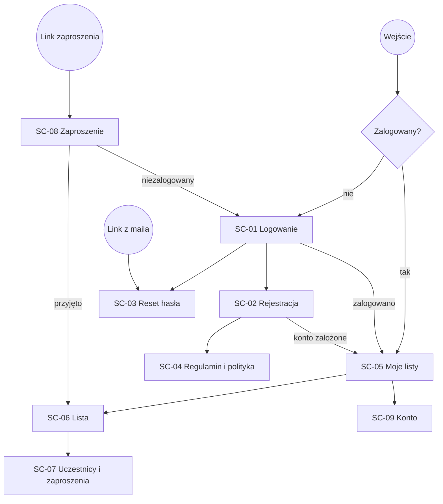
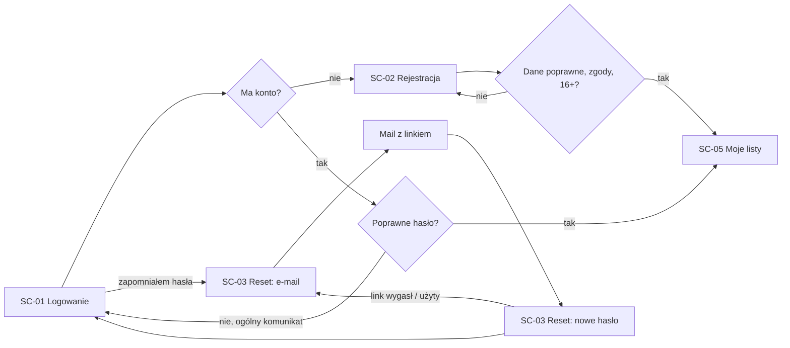
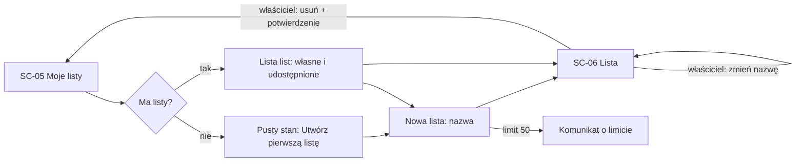
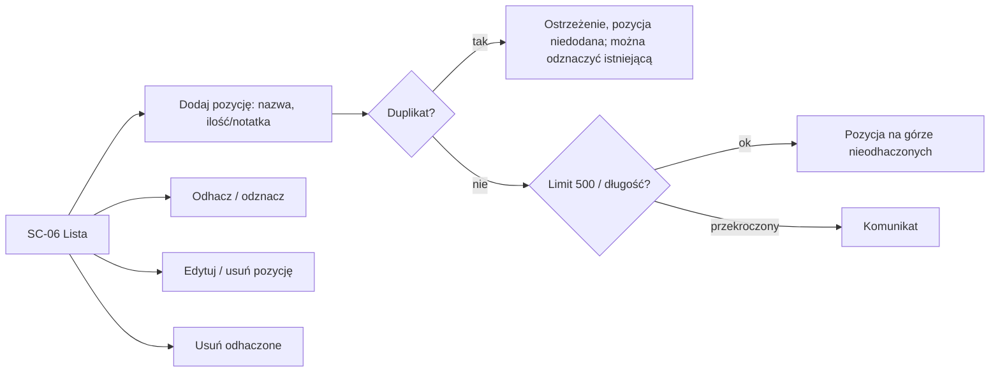
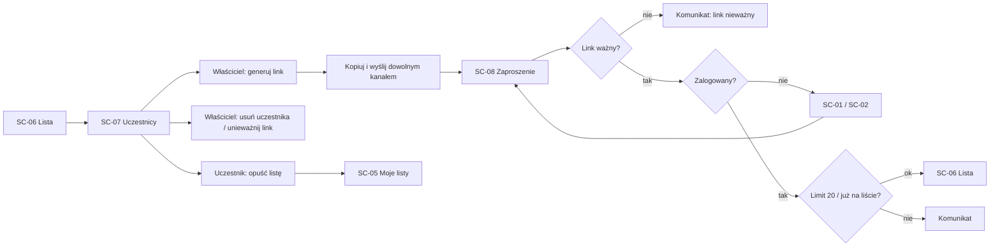
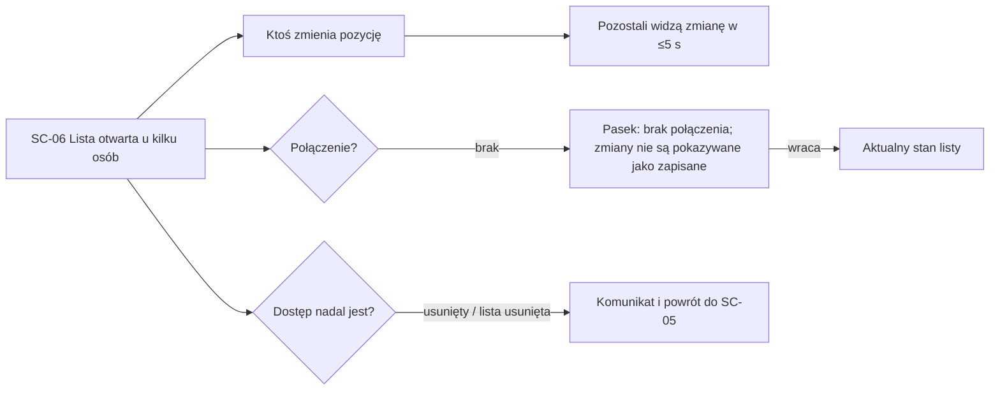

# Architektura informacji

Jakie ekrany istnieją, jak się łączą i którą drogą użytkownik przechodzi każdą główną ścieżkę. Tylko struktura, bez wyglądu.

## Ekrany

| ID | Ekran | Cel (jedno zdanie) | Wymagania | Platformy | Dostęp |
| --- | --- | --- | --- | --- | --- |
| SC-01 | Logowanie | Domownik loguje się e-mailem i hasłem; stąd przejście do rejestracji i resetu hasła | F-02 | web (telefon, komputer) | public |
| SC-02 | Rejestracja | Zakłada konto: imię, e-mail, hasło, akceptacja regulaminu i polityki prywatności, potwierdzenie 16+ | F-01, F-12 | web | public |
| SC-03 | Reset hasła | Prosi o link resetu (krok 1) i ustawia nowe hasło z linku z maila (krok 2) | F-03 | web | public |
| SC-04 | Regulamin i polityka prywatności | Czyta regulamin i politykę prywatności przed rejestracją i później | F-01, N-02 | web | public |
| SC-05 | Moje listy | Widzi własne i udostępnione listy, tworzy nową; pusty stan „Utwórz pierwszą listę” | F-05, F-06, F-14, F-15 | web | signed-in |
| SC-06 | Lista | Dodaje, edytuje, usuwa, odhacza pozycje; widzi kto dodał/odhaczył; zmiany innych na bieżąco; właściciel zmienia nazwę i usuwa listę | F-05, F-07, F-08, F-09, F-10, F-14, F-15 | web | właściciel, uczestnik |
| SC-07 | Uczestnicy i zaproszenia | Widzi uczestników; właściciel generuje i unieważnia linki, usuwa uczestników; uczestnik opuszcza listę | F-11, F-13 | web | właściciel, uczestnik |
| SC-08 | Zaproszenie | Otwiera link zaproszenia: przyjmuje je albo widzi, że link nie działa / limit / już jest na liście | F-11, F-12 | web | public → signed-in |
| SC-09 | Konto | Widzi swój e-mail, zmienia imię, wylogowuje się, usuwa konto | F-02, F-04, F-16 | web | signed-in |

Dostęp: `public` · `signed-in` · `właściciel` / `uczestnik` (role na liście, BRD §3).

Elementy wspólne (nie są osobnymi ekranami): pasek „brak połączenia” (F-15) na SC-05–SC-09; komunikat „lista została usunięta / nie masz już dostępu” (F-13, F-14) na SC-06 i SC-07.

## Nawigacja

Wzorzec: jedna kolumna, mobile-first. Na telefonie nagłówek z tytułem ekranu, przyciskiem „wstecz” i menu (konto); bez dolnych zakładek — aplikacja ma jedną główną gałąź (listy → lista). Na komputerze ten sam układ, wyśrodkowany, o ograniczonej szerokości.

Punkty wejścia: adres aplikacji, link zaproszenia (SC-08), link resetu hasła z maila (SC-03, krok 2). Wszystko poza SC-01–SC-04 i SC-08 wymaga zalogowania; niezalogowany kierowany jest na SC-01 i po zalogowaniu wraca tam, skąd przyszedł.

## Główne ścieżki

### J-01 Rejestracja i logowanie

### J-02 Zarządzanie listami

### J-03 Pozycje na liście

### J-04 Udostępnianie listy

### J-05 Wspólne zakupy

## Pokrycie wymagań

| Wymaganie | Priorytet | Ekrany | Pokryte |
| --- | --- | --- | --- |
| F-01 | must | SC-02, SC-04 | tak |
| F-02 | must | SC-01, SC-09 | tak |
| F-03 | must | SC-03 | tak |
| F-04 | must | SC-09 | tak |
| F-05 | must | SC-05, SC-06 | tak |
| F-06 | must | SC-05 | tak |
| F-07 | must | SC-06 | tak |
| F-08 | must | SC-06 | tak |
| F-09 | must | SC-06 | tak |
| F-10 | must | SC-06 | tak |
| F-11 | must | SC-07, SC-08 | tak |
| F-12 | must | SC-08, SC-02 | tak |
| F-13 | must | SC-07 | tak |
| F-14 | must | SC-05, SC-06 | tak |
| F-15 | must | SC-05–SC-09 (pasek) | tak |
| F-16 | must | SC-09 | tak |

Ekrany bez wymagania: brak.

## Otwarte pytania

- [x] Jak przedstawiać osobę (F-10, F-13)? — imieniem z konta; BRD v1.2 (F-01, F-16).
- [x] Edycja pozycji: dotknięcie nazwy otwiera arkusz edycji od dołu (SC-06, BottomSheet).
- [x] Maksymalna długość nazwy listy — 100 znaków (BRD v1.3, F-05).

## Historia zmian

| Data | Zmiana | Change ID |
| --- | --- | --- |
| 2026-10-26 | Pierwsza wersja IA | |
| 2026-10-26 | Imię na SC-02, F-16 na SC-09 (BRD v1.2); IA zaakceptowana przez właściciela | |
| 2026-10-26 | Projekt zatwierdzony przez właściciela | |
